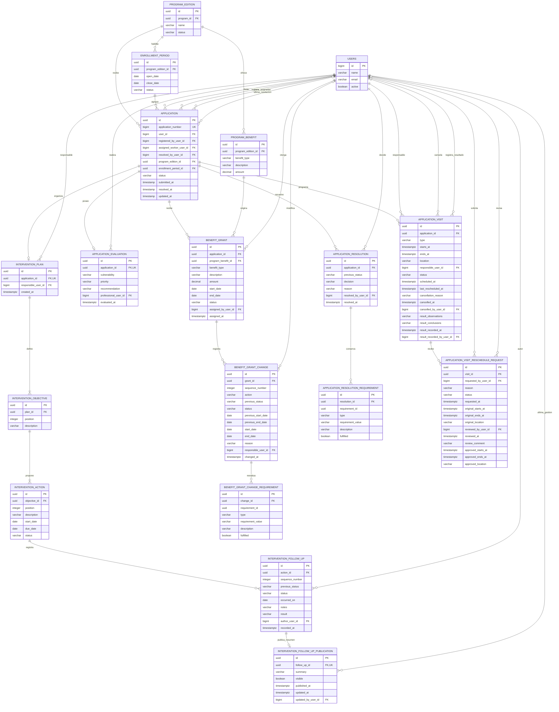

# Diagrama de entidades del seguimiento social

Este diagrama resume la evaluación social, los planes de intervención y seguimientos, las visitas o entrevistas, sus resultados, las solicitudes ciudadanas de reprogramación, las resoluciones y los otorgamientos de beneficios. El modelo completo y sus restricciones de base se mantienen en [`api-entities.dbml`](api-entities.dbml).

## Decisiones representadas

- El ciudadano consulta exclusivamente sus planes y su estructura acordada. El estado del plan se calcula desde sus acciones, sin columna nueva. Solo se proyectan seguimientos con publicación visible; notas y resultados originales permanecen privados. La publicación es opcional, única por seguimiento y conserva únicamente el resumen actual, incluso retirado. Publicar, corregir o retirar se serializa con solicitud, plan, acción y seguimiento; la auditoría no copia textos. La migración no publica registros anteriores.

- Cada solicitud evaluada admite un plan de intervención, incluso rechazada o cerrada. El ciudadano se deriva del caso. Objetivos, acciones, responsable y fechas iniciales se conservan; solo cambia el estado de las acciones mediante seguimientos inmutables. Completar acciones no modifica estados ni cupos de la solicitud.
- Cada otorgamiento conserva una copia del beneficio configurado, su vigencia, estado inicial `ACTIVE` y administrativo responsable. La unicidad por solicitud y beneficio evita duplicados; no vuelve a ocupar el cupo reservado al aprobar.
- El historial inmutable registra asignación, renovación, suspensión, finalización y vencimiento con motivo, responsable y fecha UTC. Renovar extiende el mismo otorgamiento antes de vencer y reevalúa requisitos y documentos. El vencimiento automático cambia `ACTIVE/SUSPENDED` con `endDate < hoy` a `EXPIRED`, con responsable ID null y nombre Sistema. Suspender conserva la reserva; finalizar o vencer el último otorgamiento pendiente cierra la solicitud en `CLOSED` y libera exactamente una reserva. `FINALIZED` y `EXPIRED` son definitivos.

- Las resoluciones son inmutables y preservan una copia del requisito evaluado sin FK al catálogo editable. La solicitud mantiene el estado y el responsable de la última resolución; aprobar incrementa el cupo ocupado de la edición.

- `ApplicationEvaluation` es 1:1 con `Application`; la unicidad de `application_id` impide una segunda evaluación.
- Una solicitud puede tener muchas actuaciones `VISIT` o `INTERVIEW`.
- Cancelación y resultado forman parte de `ApplicationVisit`; no son entidades independientes. Sus columnas son mutuamente excluyentes mediante `ck_application_visit_lifecycle_data`.
- La reprogramación aplicada conserva el horario vigente y `last_rescheduled_at` en la visita. La petición ciudadana sí tiene entidad propia para preservar su motivo, snapshot, decisión e historial.
- Una visita admite muchas peticiones históricas, pero el índice parcial `uk_visit_reschedule_request_pending` permite como máximo una en estado `PENDING`.
- Las referencias opcionales a usuarios corresponden al trabajador asignado, actor de cancelación, profesional de resultado y revisor. Las claves foráneas impiden eliminar usuarios todavía referenciados.
- La trazabilidad se guarda en `logs` mediante `entity_type` y `entity_id`; ese vínculo es polimórfico y por eso no se dibuja como una clave foránea inexistente.
