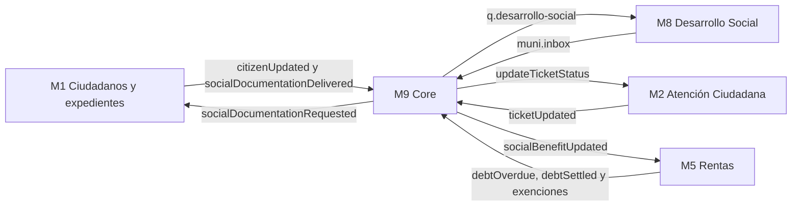

# 06. Integraciones con otros módulos, paso a paso

[Índice](README.md) · [Anterior](05-salud-y-actividades.md) · [Siguiente: catálogo de eventos](07-catalogo-de-eventos.md)

## 1. Mapa de conexiones

| Contraparte funcional | Qué recibe M8 | Qué envía M8 | Medio implementado |
| --- | --- | --- | --- |
| M1 Ciudadanos, organizaciones y expedientes | Datos/estado de ciudadanos vinculados; referencias de expedientes y documentación pedida. | Pedido de requisitos documentales de una solicitud. | Eventos mediante Core. Cliente HTTP de login disponible, desactivado por defecto; endpoint proxy y sesión pendientes. Acceso al archivo pendiente de acuerdo. |
| M2 Atención Ciudadana | Tickets derivados, respuestas, cambios de prioridad/escalamiento, reaperturas y cierres. | Hechos de inicio, avance, información requerida, devolución, resolución o rechazo operativo. | Eventos mediante Core. |
| M5 Rentas | Deudas vencidas/canceladas, pedidos y resultados de exención. | Alta y cambios de cada beneficio otorgado. | Eventos mediante Core. |
| M9 Core | Entrega de eventos y respuestas de diagnóstico/registro. | Eventos producidos y consultas técnicas autenticadas. | AMQPS para mensajes; HTTPS para API de máquina. |

Las contrapartes de la tabla indican el destino de negocio. M8 publica en el ingreso compartido y Core decide el ruteo efectivo a partir de su registro. No se crean conexiones directas a bases ajenas ni se escriben sus datos.

## 2. M1: vinculación e identidad

El [contrato de login integrado con M1](../technical/m1-auth-contract.md) registra el endpoint confirmado, el uso de `citizenId` UUID, la sesión propia de M8 y los ejemplos documentados de éxito `200` y error `401`. El cliente HTTP y sus pruebas locales están implementados, con `M1_AUTH_ENABLED=false` por defecto. La resolución de cuentas, el endpoint proxy y su sesión todavía están pendientes, junto con variantes del contrato y la cuenta privada para probar el ingreso real.

| Paso | Entrada o acción | Datos que utiliza M8 | Resultado local | Salida |
| --- | --- | --- | --- | --- |
| 1 | Vincular cuenta por un procedimiento verificado. | UUID canónico de M1 y cuenta local. | `users.external_citizen_id`. Login remoto confirmado; detalles de respuesta y procedimiento de autenticación/vinculación pendientes de cierre e implementación. | No hay un evento de vinculación implementado. |
| 2 | Recibir `citizenUpdated`. | `citizenId`, `updateType`, `details`, actor y fecha del sobre. | Busca usuario vinculado; si no existe, confirma e ignora sin aprovisionarlo. | Ninguna por desconocido. |
| 3a | `REGISTERED`. | DNI, nombre/apellido y domicilio del payload. | Actualiza snapshot de nombre/DNI y domicilio con sus relojes. No crea una cuenta ni copia todo `details` al modelo local. | Ninguna. |
| 3b | `ADDRESS_UPDATED`. | `previousAddress`, `newAddress`; usa la nueva calle/número. | Actualiza domicilio si la fecha no es anterior al último cambio aplicado. | Ninguna. |
| 3c | `BLOCKED`. | Motivo y `reviewRequired`. | Registra restricción/alerta; con negocio habilitado impide nuevas solicitudes. Beneficios actuales no cambian solos. | Ninguna automática. |
| 3d | `DECEASED`. | `deceasedAt`, origen de la información y `eventId`. | Finaliza beneficios activos/suspendidos de casos abiertos, cancela visitas programadas, cierra solicitudes y libera las reservas correspondientes. | `socialBenefitUpdated/FINALIZED` por beneficio, con causa del evento recibido. |

Nombre/DNI y domicilio tienen relojes separados para evitar que un registro inicial atrasado pise un domicilio más reciente. El fallecimiento se trata como condición terminal para nuevas presentaciones. Los payloads actuales no implementan una sincronización completa de grupo familiar o ingresos; esos datos no se deducen del UUID ni del estado tributario.

## 3. M1: pedir, recibir y revisar documentación

| Paso | Quién actúa | Qué recibe o lee | Qué guarda/hace M8 | Evento de entrada/salida |
| --- | --- | --- | --- | --- |
| 1 | Ciudadano o administrativo | Convocatoria y titular de la presentación. | Crea solicitud local y lee requisitos de su edición. | Hecho interno `ApplicationSubmitted`. |
| 2 | M8 | UUID canónico, IDs de solicitud/programa/edición y catálogo documental. | Construye pedido, máximo diez requisitos, y lo guarda en outbox junto con la solicitud. | **Salida** `socialDocumentationRequested`. |
| 3 | Core/M1 | Pedido de documentación. | M8 espera; no considera que el broker haya probado la entrega documental. | M1 debe responder con correlación/cadena causal del pedido. |
| 4 | M1 | Estado de expedientes y de pedidos documentales. | M8 recibe IDs de solicitud, ciudadano, programa, edición, `files[]` y sus `documentationRequests[]`. | **Entrada** `socialDocumentationDelivered`. |
| 5 | M8 | Identificadores y causa recibidos. | Verifica solicitud, pertenencia, edición/programa, requisito/código y `causationId` contra un pedido propio en outbox. Una solicitud desconocida se confirma sin efectos. | No emite respuesta automática. |
| 6 | M8 | Estado `PENDING` o `COMPLETED` y `documentId`. | Conserva referencias en `social_external_documentation`. `COMPLETED` con documento aún queda pendiente de revisión humana. | Sin evento externo nuevo. |
| 7 | Administrativo autorizado | Referencia del documento entregado. | Revisa como `VALID` u `OBSERVED`. Debe contar con acceso autorizado al contenido de M1, todavía pendiente de coordinar. | Sin evento externo nuevo. |
| 8 | Resolución/renovación | Revisión vigente de requisitos obligatorios. | Integra la revisión externa al control documental; una entrega local del mismo requisito prevalece si existe. | El siguiente evento depende de la decisión/otorgamiento, no de la mera revisión. |

La correlación del pedido es `application.id`. La respuesta debe conservar ese `correlationId` y usar como `causationId` el `eventId` del pedido. El cruce documental utiliza `requirementId`, no el nombre visible del archivo.

Un cambio de referencia o estado recibido vuelve a dejar pendiente la revisión. Los mensajes se comparan temporalmente para no sustituir referencias con una actualización anterior. El evento no incluye bytes ni autoriza a inventar una URL de descarga. El archivo local y el `documentId` de M1 son referencias de sistemas distintos.

## 4. M2: recibir la derivación y abrir gestión

| Paso | Entrada/acción | Qué recibe o valida M8 | Resultado local | Salida |
| --- | --- | --- | --- | --- |
| 1 | Core entrega `ticketUpdated`. | Sobre, contrato, origen M2, UUID y payload. La inbox deduplica por `eventId`. | Reserva procesamiento en la transacción. | Ack después del commit; no es un evento de negocio. |
| 2 | Revisar fecha. | `data.updatedAt`, no `occurredAt`. | Descarta un cambio anterior al cursor del ticket. | Ninguna. |
| 3 | Revisar área. | `responsibleAreaId`. | Si dejó de ser M8, cierra la gestión local existente y detiene respuestas; de un ticket ajeno no crea gestión ni copia contenido. Conserva cursor técnico. | Ninguna. |
| 4 | Revisar reclasificación. | `INFORMATION_REQUIRED`/`INFORMATION_PROVIDED` con `purpose=RECLASSIFICATION`. | Ignora la actuación de reclasificación una vez atendido el cambio de área. | Ninguna. |
| 5 | Procesar `ROUTED` dirigido a M8. | Identidad o anonimato, prioridad y snapshot de `details.routing`. | Crea/actualiza una única gestión y conserva correlación, evento de derivación, causa de respuesta y fecha fuente. | Todavía no publica `STARTED`. |
| 6 | Un administrativo toma el ticket. | Permiso y asignación válida. | Inicia la gestión una vez por ciclo de derivación. | **Salida** `updateTicketStatus/STARTED`. |
| 7 | Vincular solicitud, cuando exista. | Ticket identificado y solicitud del mismo ciudadano canónico, sin vínculos incompatibles. | Guarda relación ticket-solicitud. No crea automáticamente una convocatoria o presentación. | Puede emitir `STARTED` si la solicitud ya tiene trabajador y el ciclo aún no fue iniciado. |

El vínculo se gestiona con `PUT /api/admin/integrations/core/tickets/{ticketId}/application`. El ticket puede recibirse antes de que exista una solicitud; por eso se conserva en una tabla propia y no solo en `application.origin_ticket_id`.

Un ticket anónimo conserva su gestión y puede responderse sin usuario local; no se vincula a una solicitud que exija un titular identificado. Un nuevo `ROUTED` con `reassignment=true` reinicia el ciclo de toma, limpia datos de continuación aplicables y permite un nuevo `STARTED`.

## 5. M2: avance, información adicional y resultado

| Paso o variante | Dirección/evento | Datos o hecho | Efecto y regla |
| --- | --- | --- | --- |
| Asignación de trabajador al caso vinculado | Salida `updateTicketStatus/STARTED`, si falta iniciar. | Toma de gestión. | Una vez por ciclo; después de `REOPENED` o `INFORMATION_PROVIDED` no se reinicia. |
| Programación o reprogramación de visita | Salida `updateTicketStatus/PROGRESS`. | Fecha/franja en mensaje público y progreso. | Automática desde el hecho local si la gestión admite avances. |
| Avance manual | Salida `updateTicketStatus/PROGRESS`. | Texto público/interno, progreso o adjuntos referenciados. | Debe aportar al menos uno; no se envían binarios. |
| Falta información del ciudadano | Salida `updateTicketStatus/INFORMATION_REQUIRED`. | `informationRequest.messageForCitizen`, vencimiento opcional. | Un pedido activo por ticket. La gestión queda esperando información. |
| El ciudadano responde en M2 | Entrada `ticketUpdated/INFORMATION_PROVIDED`. | Mensaje en `details.informationResponse` y adjuntos en `data.attachments`. | Conserva respuesta, libera espera, avisa mediante atención pendiente y actualiza la causa para continuar. |
| Retomar la gestión | Salida `updateTicketStatus/PROGRESS` o `/RESOLVED`. | Hecho posterior a la respuesta. | Usa la correlación y el `eventId` causal del nuevo mensaje de M2. Nunca otro `STARTED`. |
| Aprobar la solicitud vinculada | Salida `updateTicketStatus/RESOLVED`. | `resolution.type=REQUEST_FULFILLED`, mensaje público obligatorio. | Comunica aprobación del trámite; no afirma que ya se asignó el beneficio. |
| Rechazar tras evaluación | Salida `updateTicketStatus/RESOLVED`. | `resolution.type=NO_FURTHER_ACTION_REQUIRED`, mensaje público. | Es un resultado evaluado; M2 determina confirmación/reapertura. |
| Dejar en espera | Sin salida automática específica. | `WAITLISTED` local. | No se publica un `socialBenefitUpdated` ni se resuelve automáticamente el ticket. |
| Devolver a M2 | Salida `updateTicketStatus/RETURNED`. | `returnInfo.reasonCode` y mensaje público o interno. | Detiene gestión local; por ejemplo, área incorrecta o contexto insuficiente. |
| Rechazo operativo | Salida `updateTicketStatus/REJECTED`. | `cancellation.reasonCode` y mensaje público o interno. | Caso que M8 no puede gestionar; no equivale al rechazo social después de evaluar. |

Las variantes `RETURNED`, `RESOLVED` y `REJECTED` son alternativas, no una secuencia obligatoria. M8 informa hechos; M2 decide el estado central del ticket, la clasificación y la prioridad. La gestión local y `currentStatus` recibido no son el mismo atributo.

### Cambios posteriores que llegan desde M2

| `ticketUpdated.updateType` | Qué hace M8 | Respuesta automática |
| --- | --- | --- |
| `PRIORITY_CHANGED` | Actualiza la prioridad recibida. | Ninguna. |
| `ESCALATION_CHANGED` | Actualiza `details.escalation`; marca atención cuando pasa a activo. | Ninguna. |
| `REOPENED` | Reactiva gestión, guarda motivo y nueva causa/correlación para continuar. No reabre por sí mismo la solicitud social. | Ninguna inmediata; las respuestas posteriores son `PROGRESS` o `RESOLVED`. |
| `CANCELLED` | Cierra gestión y detiene publicaciones, incluso si venció un pedido de información. | Ninguna. |
| `DUPLICATE_LINKED` | Deja de gestionar el duplicado; el ticket principal se trata por su propia identidad. | Ninguna. |
| `CLOSED` | Cierra gestión local. | Ninguna. |
| `STATUS_CHANGED`, `CONTENT_UPDATED`, `PROGRESS`, `RESOLVED`, `INFORMATION_REQUIRED` ordinario | Se confirman sin ejecutar una transición operativa específica de respuesta; el servicio conserva metadatos comunes de una gestión conocida. | Ninguna; no se genera un eco. |

La corrección del filtro garantiza que una reclasificación con área nueva cierre primero la gestión local. Su fecha también actualiza el cursor: una derivación M8 más antigua no puede reabrirla.

## 6. M5: comunicar nuestros beneficios

| Paso | Actor/hecho | Datos transmitidos | Evento y efecto esperado en la contraparte |
| --- | --- | --- | --- |
| 1 | M8 aprueba solicitud. | Estado local y reserva. | Todavía no hay evento de beneficio a Rentas. |
| 2 | M8 asigna cada beneficio. | Beneficio, ciudadano, solicitud, programa/edición, tipo, monto, vigencia y fecha del cambio. | Salida `socialBenefitUpdated/APPROVED`, una por otorgamiento. |
| 3 | M8 renueva o reactiva mediante renovación. | Mismo `benefitId`, nueva vigencia y cambio más reciente. | Salida `socialBenefitUpdated/APPROVED`. |
| 4 | M8 suspende. | Identidad estable y motivo. | Salida `socialBenefitUpdated/SUSPENDED`. |
| 5 | M8 finaliza, vence o aplica fallecimiento. | Identidad, motivo y fin efectivo correspondiente. | Salida `socialBenefitUpdated/FINALIZED`. |

Cuando `type=TAX_EXEMPTION`, Rentas recibe el hecho social para aplicar sus propias reglas tributarias. El mensaje no garantiza una exención aprobada ni modifica directamente una liquidación. `programName` utiliza el nombre de la edición y `amount` se envía aun cuando vale null.

## 7. M5: recibir deuda y exenciones

| Paso | Evento de entrada | Qué recibe M8 | Tratamiento local | Salida automática |
| --- | --- | --- | --- | --- |
| 1 | `debtOverdue` | `debtId`, ciudadano, concepto, importe pendiente y vencimiento. | Registra/actualiza contexto administrativo; no cambia elegibilidad social. No reactiva una deuda conocida ya saldada con un overdue tardío. | Ninguna. |
| 2 | `debtSettled` | Deuda, ciudadano nullable, concepto, origen, fecha y saldos. | Solo aplica a `MUNICIPAL_TAX`, ciudadano no null y deuda conocida. Otros casos se confirman e ignoran. | Ninguna. |
| 3 | `exemptionRequested` | `requestId`, ciudadano, concepto, motivo, porcentaje y período solicitados. | Registra pedido; vincula automáticamente si hay un único beneficio `TAX_EXEMPTION` activo del titular. | Ninguna. |
| 4 | Selección administrativa, si es ambigua. | Beneficio propio del mismo ciudadano. | Completa el vínculo mediante API autorizada; no altera el pedido en Rentas. | Ninguna. |
| 5a | `updateExemptionStatus/APPROVED` | Pedido, ciudadano, exención, porcentaje y fechas de vigencia. | Conserva resultado tributario y sus IDs externos. | Ninguna. |
| 5b | `updateExemptionStatus/REJECTED` | Pedido, ciudadano, concepto y motivo. | Conserva rechazo sin exigir campos exclusivos de aprobación. | Ninguna. |
| 6 | Consulta administrativa. | Contexto recibido de deuda/exenciones. | Muestra datos para gestión con permisos específicos. | Ninguna. |

El resultado de exención puede llegar antes del pedido: se conserva y luego se completa el contexto sin borrarlo. M8 mantiene `debtId`, `requestId` y `exemptionId` de Rentas; no genera sustitutos.

Estos eventos no disparan una aprobación, suspensión o cancelación automática de beneficio social. El pedido tributario tampoco crea una nueva solicitud social por sí mismo.

## 8. M9: recorrido técnico común

### Salida

1. Una operación autorizada genera un hecho local.
2. El puente construye el contrato correspondiente con UUID nuevo, origen `desarrollo-social`, versión `1.0` y correlación/causa apropiadas.
3. La misma transacción guarda cambio de negocio y outbox. Un error revierte ambos.
4. El publicador toma pendientes y envía JSON persistente al exchange `muni.inbox`, con routing key vacía, sobre AMQPS.
5. Un confirm positivo sin devolución registra `BROKER_CONFIRMED`. Ante fallo se mantiene el mismo evento/UUID para reintentar.
6. Core valida y enruta según su catálogo/suscripciones. Confirm de RabbitMQ no demuestra que el worker Core o el módulo receptor haya terminado su trabajo.

### Entrada

1. Core entrega en `q.desarrollo-social`; M8 no declara esa topología al arrancar.
2. Se validan sobre, metadatos de transporte y contrato. Los metadatos adicionales del Core, como `receivedAt`, se ignoran al construir el sobre lógico.
3. Se registra inbox por `eventId`. Un duplicado idéntico no vuelve a ejecutar efectos; un mismo ID con contenido distinto es conflicto.
4. El handler aplica el flujo de negocio dentro de la transacción. Un evento reconocido que no aplica al caso se procesa sin efectos de negocio.
5. Después del commit se confirma con ack. Un error revierte y se rechaza sin requeue local; reintentos y DLQ dependen del circuito Core.

Un tipo o versión sin handler no se acepta como una gestión conocida: se rechaza. Esta situación es distinta de un `ticketUpdated` válido destinado a otra área o un `debtSettled` válido de otro origen, que sus handlers sí reconocen e ignoran.

### HTTP técnico

El backend puede obtener un token de máquina y consultar estado, catálogo, publicaciones, suscripciones, eventos y entregas mediante la API de Core. El dashboard propio concentra siete consultas protegidas bajo `/api/admin/integrations/core`. Las credenciales permanecen en el backend. No hay registro automático de los contratos o suscripciones de negocio al iniciar.

## 9. Conexiones previstas por la consigna que no forman parte de estos diez eventos

- **Expedientes es parte de M1:** ya recibimos referencias en `socialDocumentationDelivered`, pero no existe un handler independiente `ExpedienteIniciado` ni un evento genérico para remitir toda actuación y resultado al expediente.
- **Notificaciones es parte de M9:** no están implementados aquí consumos `NotificacionEnviada`/`NotificacionFallida` ni publicaciones específicas para todos los turnos, visitas o resultados. Un mensaje público a M2 no acredita una notificación externa enviada al vecino.
- No hay un circuito directo vigente de M8 con Obras, Ambiente, Habilitaciones o Tránsito dentro del catálogo actual.

## 10. Operaciones administrativas para estos intercambios

| Operación HTTP | Uso en el recorrido | Permiso |
| --- | --- | --- |
| `GET /api/admin/integrations/core/tickets` y `/{ticketId}` | Consultar gestiones recibidas y su snapshot. | `tickets:management:view`. |
| `PUT /api/admin/integrations/core/tickets/{ticketId}/assignee` | Asignar responsable e iniciar el ciclo cuando corresponde. | `tickets:management:manage`. |
| `PUT /api/admin/integrations/core/tickets/{ticketId}/application` | Relacionar una solicitud identificada del mismo titular. | `tickets:management:manage`. |
| `POST /api/admin/integrations/core/tickets/{ticketId}/updates` | Encolar respuesta manual a M2; devuelve `202` y `eventId` con estado `PENDING`. | `tickets:management:manage`. |
| `GET /api/admin/applications/{applicationId}/external-documents` | Consultar referencias de M1 y su revisión local. | `applications:management:documents:view`. |
| `PATCH /api/admin/applications/{applicationId}/external-documents/{requestId}/review` | Revisar una entrega externa `COMPLETED` pendiente, dentro de los estados admitidos del caso. | `applications:management:documents:review`. |
| `GET /api/admin/integrations/core/citizen-alerts` | Consultar restricciones y fallecimientos del snapshot. | `users:view`. |
| `GET /api/admin/integrations/core/revenue/debts` y `GET /api/admin/integrations/core/revenue/exemptions` | Consultar contexto tributario recibido. | `revenue:management:view`. |
| `PUT /api/admin/integrations/core/revenue/exemptions/{requestId}/benefit` | Resolver el vínculo con una prestación propia del titular. | `revenue:management:manage`. |

Las rutas requieren sesión y permiso del rol activo; los servicios vuelven a comprobar las autorizaciones vigentes. Una respuesta `202 PENDING` confirma persistencia local, no aceptación de M2. Los listados de tickets, Rentas y alertas utilizan página desde cero y tamaño de 1 a 100; los filtros y cuerpos completos están en Swagger.

## 11. Referencias

- [Catálogo y payloads](07-catalogo-de-eventos.md).
- [Recepción de tickets](../../src/main/kotlin/com/uade/dda2/server/feature/integration/service/SocialTicketIncomingService.kt) y [respuestas](../../src/main/kotlin/com/uade/dda2/server/feature/integration/service/SocialTicketEventService.kt).
- [Documentación externa](../../src/main/kotlin/com/uade/dda2/server/feature/integration/service/ExternalDocumentationService.kt), [Ciudadanos](../../src/main/kotlin/com/uade/dda2/server/feature/integration/service/CitizenIncomingService.kt) y [Rentas](../../src/main/kotlin/com/uade/dda2/server/feature/integration/service/RevenueIncomingService.kt).
- [Inbox](../../src/main/kotlin/com/uade/dda2/server/feature/integration/service/CoreInboxService.kt), [outbox](../../src/main/kotlin/com/uade/dda2/server/feature/integration/service/CoreOutboxService.kt) y [transporte Core](../technical/core-integration.md).
