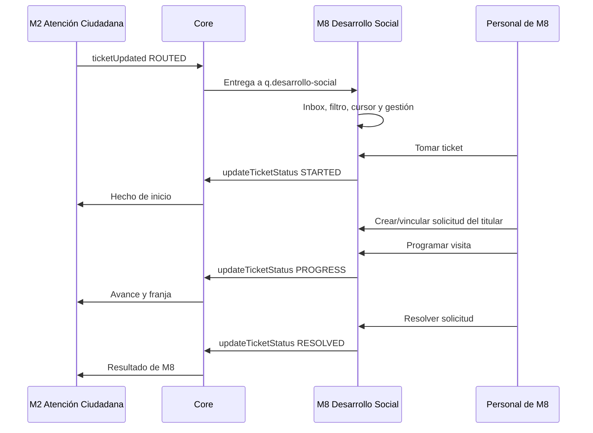

# 08. Recorridos completos, controles y pendientes

[Índice](README.md) · [Anterior: catálogo](07-catalogo-de-eventos.md)

## 1. Solicitud directa con documentos y beneficio

| Paso | Acción | Datos o cambio local | Evento de integración |
| --- | --- | --- | --- |
| 1 | El municipio prepara programa, edición, documentos y convocatoria. | Oferta activa y recepción abierta. | Ninguno. |
| 2 | El titular vinculado presenta solicitud. | `SUBMITTED`, número y referencia a convocatoria. | Sale `socialDocumentationRequested`, correlación de la solicitud. |
| 3 | M1 informa los documentos. | Referencias de expediente/requisito/documento; revisión local pendiente. | Entra `socialDocumentationDelivered`, con causa del pedido. |
| 4 | El administrativo revisa contenido. | Documentos obligatorios `VALID`, o `OBSERVED` si requieren corrección. | Ninguno automático. |
| 5 | El trabajador evalúa. | Asignación y `IN_EVALUATION`. | Sin salida a M2 si no hay ticket vinculado. |
| 6 | Programa actuación si hace falta. | `IN_VISIT`; luego resultado y regreso a evaluación. | Sin salida a M2 si no hay ticket vinculado. |
| 7 | Se aprueba con requisitos y cupo. | `APPROVED`, reserva una incorporación. | Aún no sale evento de beneficio. |
| 8 | Se concede una prestación concreta. | Otorgamiento `ACTIVE`, vigencia e historial. | Sale `socialBenefitUpdated/APPROVED`. |
| 9 | Rentas aplica su circuito, si corresponde. | M8 no cambia datos tributarios ajenos. | Puede entrar un `updateExemptionStatus` relacionado con un pedido de Rentas; no debe suponerse una respuesta directa universal a todo beneficio. |
| 10 | Se renueva, suspende o termina. | Mismo otorgamiento e historial creciente. | Sale `socialBenefitUpdated` con el estado correspondiente. |
| 11 | Finaliza o vence el último otorgamiento. | Solicitud `CLOSED`, libera una reserva. | Sale el último `socialBenefitUpdated/FINALIZED`; no hay evento separado de cierre de solicitud en el catálogo. |

Si el ciudadano entrega archivos directamente en M8, la carga/revisión local sustituye ese tramo documental para los requisitos correspondientes. No debe suponerse que cada alta local exige necesariamente una entrega externa para continuar.

## 2. Solicitud que llega por Atención Ciudadana

El diagrama omite las entregas/acks técnicos y el tramo documental para mostrar la causalidad de la gestión. En este recorrido:

1. El ticket se registra antes de crear la solicitud, conservando su UUID y correlación.
2. La solicitud se presenta en una convocatoria válida y se vincula administrativamente; no nace automáticamente solo por recibir `ROUTED`.
3. El pedido documental, si corresponde, usa la correlación de la solicitud. Las respuestas al ticket usan la correlación de M2. Son dos hilos relacionados, no el mismo identificador por definición.
4. Asignación y visita producen las salidas condicionales de M2; una evaluación no crea otro `STARTED` si el ciclo ya se inició.
5. La aprobación se comunica como `RESOLVED/REQUEST_FULFILLED`; el rechazo evaluado, como `RESOLVED/NO_FURTHER_ACTION_REQUIRED`.
6. Solo después de conceder cada prestación sale `socialBenefitUpdated` hacia Rentas.

## 3. Ticket anónimo o sin posibilidad de tramitar

Un `ticketUpdated/ROUTED` anónimo puede abrir gestión y recibir inicio, avances y respuesta sin crear usuario. No puede vincularse a una solicitud identificada inventando un titular.

Si falta contexto, el personal puede pedir información con `updateTicketStatus/INFORMATION_REQUIRED`. La respuesta llega como `ticketUpdated/INFORMATION_PROVIDED` y permite continuar sin otro `STARTED`.

Si corresponde a otra área, se puede devolver con `RETURNED`. Si M8 no puede gestionarlo operativamente, puede usar `REJECTED` con motivo. Si un evento más reciente ya indica `responsibleAreaId` ajeno, M8 cierra primero la gestión local y no publica una nueva respuesta; esto también se aplica a eventos de reclasificación. Una derivación atrasada no la reabre.

Cerrar ese ticket no implica cancelar automáticamente una solicitud o revertir un beneficio ya existente. La actuación sobre esos objetos requiere su propio caso de uso.

## 4. Fallecimiento con prestaciones y visitas pendientes

| Paso | Entrada/acción | Resultado | Evento |
| --- | --- | --- | --- |
| 1 | M1 informa fallecimiento de persona ya vinculada. | M8 identifica los casos abiertos y registra condición terminal. | Entrada `citizenUpdated/DECEASED`. |
| 2 | Finalizar otorgamientos `ACTIVE` y `SUSPENDED`. | Mantiene historia y fecha efectiva de fallecimiento. | Salida `socialBenefitUpdated/FINALIZED` por cada uno; causa del evento M1. |
| 3 | Cancelar visitas `SCHEDULED`. | Motivo, fecha y atribución al evento externo. | No hay un evento específico de cancelación de visita. |
| 4 | Cerrar solicitudes abiertas. | `CLOSED`; conserva resoluciones históricas. | No hay un evento genérico de cierre de solicitud. |
| 5 | Liberar reservas de casos aprobados. | Ajusta contador de edición una vez por caso. | Sin evento externo adicional. |
| 6 | Confirmar transacción e inbox. | Todo se confirma junto; cualquier fallo revierte el conjunto. | Ack posterior al commit. |
| 7 | Recibir repetición del mismo UUID. | La inbox detecta duplicado y evita repetir cierres o publicaciones. | No se generan nuevos eventos por el replay idéntico. |

## 5. Deuda y exención sin automatizar una decisión social

1. Rentas publica `debtOverdue`; M8 conserva el contexto para consulta.
2. El administrativo puede revisar esa información; el evento no rechaza la solicitud ni suspende prestaciones.
3. Rentas publica `exemptionRequested`; M8 conserva el pedido y busca una prestación `TAX_EXEMPTION` activa del titular.
4. Si hay una coincidencia inequívoca, la vincula; si hay varias, un administrativo selecciona la correspondiente.
5. Rentas informa `updateExemptionStatus`, aprobado o rechazado. M8 conserva la decisión tributaria y no genera un eco ni un beneficio nuevo por ese hecho.
6. Una cancelación municipal conocida llega mediante `debtSettled` y marca la deuda saldada. Los orígenes ajenos al circuito tributario municipal se ignoran.

Estos pasos pueden recibirse fuera de orden en los casos soportados; no requieren que todos los mensajes formen una secuencia única ni que una exención nazca de cada beneficio.

## 6. Relación entre hechos internos y eventos externos

| Hecho/operación local | Hecho interno del backend | Salida externa |
| --- | --- | --- |
| Crear programa, editar edición, abrir convocatoria | Sin puente de negocio a Core en estas acciones. | Ninguna. |
| Presentar solicitud propia/asistida | `ApplicationSubmitted`. | `socialDocumentationRequested` si la edición exige documentos. |
| Asignar trabajador o registrar evaluación | `WorkerAssigned`. | `updateTicketStatus/STARTED` si corresponde al ciclo del ticket vinculado. |
| Programar o reprogramar visita, incluida aprobación de reprogramación ciudadana | `VisitScheduled`. | `updateTicketStatus/PROGRESS` si la gestión lo permite. |
| Cancelar visita o registrar su resultado | Auditoría/actualización del caso; no hay ese puente externo específico. | Ninguna automática específica. |
| Aprobar o rechazar solicitud por cualquiera de las dos rutas existentes | `ApplicationResolved`. | `updateTicketStatus/RESOLVED` si existe gestión vinculada elegible. |
| Dejar solicitud en espera | `ApplicationResolved` con `WAITLISTED`, sin publicación automática de resolución. | Ninguna automática específica. |
| Otorgar, renovar, suspender, finalizar o vencer prestación | `BenefitChanged`. | `socialBenefitUpdated`. |
| Finalización de prestación causada por M1 | `BenefitChanged`, con causa externa. | `socialBenefitUpdated/FINALIZED`, conservando `causationId`. |
| Revisar archivo/referencia, crear plan, registrar seguimiento o publicar resumen ciudadano | Operación local y auditoría correspondiente. | Ninguna. |
| Reservar turno, registrar atención, inscribir actividad o marcar asistencia | Operación local y auditoría correspondiente. | Ninguna. |

La columna de salida presupone integración de negocio habilitada. «Sin evento externo» no significa que falte guardar el cambio local ni que el sistema no lo audite.

## 7. Estado implementado frente a habilitación real

| Área | Disponible en código | Lo que sigue pendiente de verificar o desarrollar |
| --- | --- | --- |
| Diez contratos M8 | Tipos, validación, tres publicaciones y siete consumos sobre outbox/inbox. | Compatibilidad con schemas y registro desplegados. |
| Tickets | Gestión, anonimato, relación con solicitud, variantes de M2 y filtro de reclasificación corregido. | Circuito completo M2-Core-M8-M2 con evidencia de procesamiento. |
| Ciudadanos | Snapshot y efectos sobre usuarios ya vinculados. | Login/vinculación verificada; compatibilidad del UUID y envelope emitidos por M1. |
| Documentación M1 | Referencias, pertenencia, causalidad y revisión local. | Obtener el contenido externo con autorización real; no se inventa un enlace. |
| Rentas | Beneficios emitidos y contexto tributario recibido. | Interoperabilidad real de los cinco tipos que vinculan M8 y M5. |
| PostgreSQL | Migraciones y persistencia implementadas. | Aplicar y probar la migración M8 en una copia, incluidas restricciones y transacciones. |
| Transporte | AMQPS, confirms, reintentos de outbox e inbox/ack. | Publicación/consumo de negocio y recuperación con servicios reales; revisión de backlog y DLQ. |
| Core HTTP | Cliente y dashboard técnico protegidos. | Confirmación de acceso HTTP desde el despliegue y registro efectivo. |
| Expedientes generales y notificaciones | Solo las referencias documentales y conexiones expresamente descritas. | Contratos adicionales para remitir toda actuación y confirmar notificaciones, si se incorpora ese alcance de la consigna. |

La revisión del 14 de noviembre ejecutó **19 pruebas de flujos M8 y 5 de contratos, sin fallos**, después de corregir la reclasificación. La prueba nueva falló con el filtro anterior y pasó con la corrección; cubre ambas variantes, fechas atrasadas, deduplicación y el bloqueo de publicaciones después del cambio de área. Son pruebas locales con H2, no evidencia de interoperabilidad remota.

## 8. Condiciones de activación

La configuración predeterminada mantiene desactivado negocio, publicación y consumo. Para un circuito habilitado se necesitan los componentes de Core, negocio, publicador y consumidor activos, además de credenciales privadas, migraciones y acuerdos efectivos.

Antes de habilitar en el entorno compartido corresponde:

1. Verificar migraciones sobre PostgreSQL y consistencia de reservas de edición.
2. Confirmar desde el despliegue HTTP, AMQPS, worker Core, nombres, schemas, tres publicaciones y siete suscripciones.
3. Resolver la identidad y acceso documental M1 necesarios para el recorrido seleccionado.
4. Revisar mensajes pendientes y outbox antes de activar consumidores/publicador.
5. Completar pruebas con M1, M2 y M5, incluyendo repetición, mensajes atrasados, contrato inválido y caída/recuperación.
6. Registrar por `eventId` la salida local, confirm del broker, registro/ruteo Core y efecto de negocio remoto. Un `BROKER_CONFIRMED` aislado no completa la evidencia.

## 9. Dónde continuar

- [Guía de habilitación y endpoints M8](../technical/m8-events.md).
- [Roadmap de negocio](../roadmaps/04-integraciones-posteriores.md) y [pruebas con Core](../roadmaps/03-core-prueba-y-habilitacion.md).
- [Evidencia técnica registrada](../roadmaps/evidencias-core.md).
- [Pruebas de flujos](../../src/test/kotlin/com/uade/dda2/server/feature/integration/M8BusinessFlowTest.kt) y [contratos](../../src/test/kotlin/com/uade/dda2/server/feature/integration/M8ContractCodecTest.kt).
