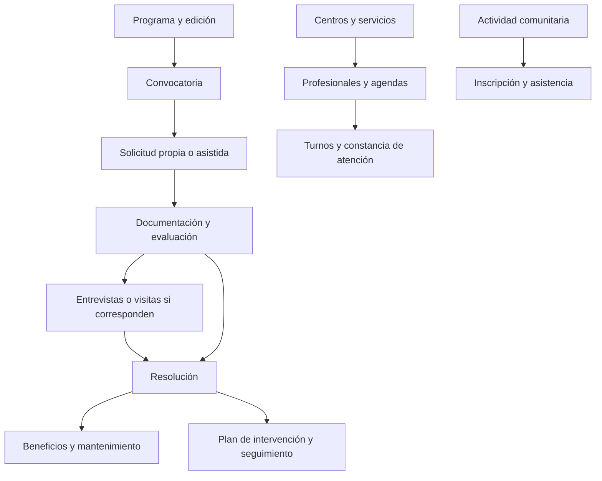

# Módulo 8: Desarrollo Social, Salud Comunitaria y Beneficios

Esta carpeta explica qué resuelve nuestro módulo, cómo se recorren sus funcionalidades y qué información intercambia con las otras áreas municipales. Está dirigida al equipo, docentes y responsables de integración que necesitan entender el sistema completo antes de leer una clase o un contrato HTTP.

**Referencia de revisión: 14 de noviembre de 2026, rama `feature/server/core-events-asyncapi`.** Describe el backend disponible en esta rama, incluida la corrección del filtro de reclasificación de tickets. No acredita que esa versión esté desplegada ni que las integraciones estén habilitadas en el ambiente compartido.

## Orden de lectura

| Documento | Contenido |
| --- | --- |
| [01. Responsabilidad, datos y acceso](01-responsabilidad-y-acceso.md) | Propósito, actores, límites del módulo, conceptos, propiedad de datos y autenticación. |
| [02. Programas, convocatorias y solicitudes](02-programas-y-solicitudes.md) | Preparación de la oferta, inscripción propia/asistida, duplicados y documentación local. |
| [03. Evaluación, visitas y resolución](03-evaluacion-visitas-y-resolucion.md) | Asignación profesional, evaluación, agenda, reprogramaciones y decisión municipal. |
| [04. Beneficios y seguimiento social](04-beneficios-y-seguimiento.md) | Otorgamiento, renovación, suspensión, vencimiento, cierre, planes y publicaciones ciudadanas. |
| [05. Centros, turnos y actividades](05-salud-y-actividades.md) | Preparación de agendas, turnos, atención comunitaria, campañas, inscripción y asistencia. |
| [06. Integraciones paso a paso](06-integraciones-paso-a-paso.md) | Qué recibimos, qué hacemos y qué enviamos en cada intercambio con M1, M2, M5 y M9. |
| [07. Catálogo de eventos](07-catalogo-de-eventos.md) | Los tres eventos publicados y siete consumidos, sus campos, variantes, correlación y reglas de procesamiento. |
| [08. Recorridos completos y estado](08-recorridos-y-estado.md) | Ejemplos de principio a fin, matriz de acciones/eventos, pendientes y evidencia disponible. |

## Qué hace el módulo

M8 organiza la asistencia social municipal: prepara programas y convocatorias, recibe solicitudes, revisa documentación, registra evaluaciones y visitas, decide incorporaciones y mantiene los beneficios concedidos. También permite acompañar a una persona mediante planes de intervención y organizar servicios de salud comunitaria, turnos y actividades.

Hay tres recorridos principales:

Los planes también pueden iniciarse antes de resolver y continuar después del cierre. El diagrama resume dependencias; no obliga a programar una visita en todos los casos.

## Cómo leer los eventos de las tablas

- **Entrada:** un hecho recibido desde otro módulo mediante Core.
- **Salida:** un evento que M8 guarda en su outbox para enviarlo mediante Core.
- **Interno:** una notificación entre componentes del mismo backend; no es un mensaje que reciba otro equipo.
- **Sin evento externo:** la operación existe, pero no tiene publicación o consumo asociado en el contrato actual.

Las salidas de negocio requieren `CORE_ENABLED=true` y `CORE_BUSINESS_ENABLED=true`. El envío y consumo de red tienen interruptores adicionales. Una operación local confirmada, un evento guardado, una confirmación de RabbitMQ y el procesamiento por la contraparte son resultados distintos.

## Alcance y fuentes

La explicación prioriza el código actual, sus validadores, los contratos tipados y las pruebas. Las guías de `functional/` conservan detalle útil por historia, pero algunas frases sobre funcionalidades «futuras» o ausencia de eventos pertenecen a incrementos anteriores. En esos casos, esta carpeta describe la ampliación disponible en la rama revisada.

Referencias principales:

- [Guía técnica vigente de eventos M8](../technical/m8-events.md).
- [Contratos registrados en el código](../../src/main/kotlin/com/uade/dda2/server/feature/integration/contract/M8EventType.kt).
- [Puente entre hechos locales y publicaciones](../../src/main/kotlin/com/uade/dda2/server/feature/integration/service/M8BusinessEventBridge.kt).
- [Guía técnica de Core](../technical/core-integration.md) y [dashboard de conexión](../technical/core-dashboard.md).
- [Roadmap de negocio y habilitación](../roadmaps/04-integraciones-posteriores.md).
- [Modelo de datos](../database/api-entities.dbml) y [migración M8](../database/migrations/2026-11-02-m8-business-events.sql).

El detalle de cuerpos HTTP y errores está en `/api-docs` y Swagger. Los contratos asincrónicos se generan en `/springwolf/docs` y su visor está en `/springwolf/asyncapi-ui.html`. Esta guía explica el negocio y los puntos de integración; no sustituye los esquemas generados ni confirma los contratos desplegados en Core.
