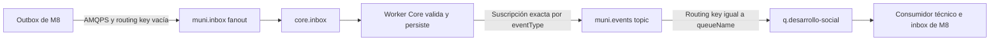

# Contrato técnico contrastado con el código de Core

Esta referencia define el comportamiento que deben considerar los [roadmaps de implementación](README.md). Se revisó el archivo `core_desappsii-main.zip` aportado por el equipo el 2 de noviembre de 2026, sin ejecutar sus scripts de despliegue, seeds o aplicaciones ni conectarse al servidor remoto.

SHA-256 del ZIP: `275a2f3675a4da496924068dbe34b560c679f70bb27dd55e91823646e807d98c`.

Las rutas de código de este documento son relativas a `core_desappsii-main/` dentro del ZIP. Este snapshot no demuestra qué commit o configuración están desplegados en AWS. Los valores públicos de conexión siguen tomándose de la guía AWS y se contrastan con Core antes de habilitar el tráfico real.

## Qué quedó definido para nuestra implementación

| Decisión local | Implementación prevista |
| --- | --- |
| Transporte de eventos | AMQPS hacia `muni.inbox`; HTTP para autenticación, registro y diagnóstico. Sin cambio automático de transporte ante fallos. |
| Cliente AMQP | `spring-boot-starter-amqp`, con versiones administradas por Spring Boot 4.0.7. Se incorporó porque el proyecto no tenía cliente RabbitMQ. |
| Serialización | Sobre tipado y `data` como árbol JSON de Jackson 3; enviar bytes JSON UTF-8 mediante `RabbitTemplate.send`, sin serialización Java ni conversores de entidades JPA. |
| Cliente HTTP | `RestClient` del stack Spring ya utilizado, sin sumar otra biblioteca HTTP. Token de máquina separado del JWT local. |
| Persistencia | Outbox e inbox en nuestro PostgreSQL, con transacciones locales y restricciones de unicidad. |
| Prueba de conexión | Publicación y suscripción propias a un tipo técnico acordado con Core. El código permite que el emisor sea también destinatario; no exige integrar otro módulo. |
| Alcance | Referencia técnica de Core. Los procesos M8 están implementados con habilitación separada; ver [etapa de negocio](04-integraciones-posteriores.md). |

El bloque técnico de esas decisiones ya está implementado en Desarrollo Social; su configuración está en la [guía técnica](../technical/core-integration.md). La [evidencia del despliegue](evidencias-core.md) confirma conexión AMQPS y consulta pasiva de la cola. Siguen pendientes las verificaciones HTTP, el intercambio real de eventos y las pruebas funcionales de outbox/inbox sobre PostgreSQL real. Este documento conserva por separado los hechos observados en el snapshot de Core.

## HTTP que consumirá el backend

Las rutas de esta tabla llevan el prefijo `/api/v1`, salvo las de salud y `/openapi.json`. Las respuestas usan camelCase.

| Método y ruta | Contrato y uso |
| --- | --- |
| `POST /auth/module-token` | Request `{"module":"desarrollo-social","secret":"<privado>"}`. Respuesta con `accessToken`, `tokenType`, `expiresIn`, `module`, `displayName`, `isAdmin`, `kind` y `actor`. Validar identidad y `kind=module`; no fijar la duración del token. |
| `GET /auth/me` | Verifica la identidad del token recibido. El resultado no representa un usuario municipal. |
| `GET /modules` | Permite contrastar el módulo y su `queueName`; el modelo admite una cola configurada distinta del nombre convencional. |
| `GET /subscriptions` | Array de suscripciones propias para un módulo no administrador. Campos: `id`, `moduleName`, `eventType`, `queueName`, `maxAttempts`, `active`. |
| `GET /publications` | Array global en este snapshot. Filtrar localmente `moduleName == desarrollo-social` antes de decidir qué declaración propia falta. |
| `GET /event-types/{name}` | Consulta exacta del tipo, su `ownerModule`, `jsonSchema`, `validates` y `discovered`. Un 404 indica ausencia. |
| `POST /event-types` | Declara el tipo técnico propio con `name`, `description`, `jsonSchema` y, opcionalmente, `ownerModule`. No reclamar tipos ajenos. |
| `PUT /event-types/{name}/schema` | Cambia el schema de `data`. Solo el dueño o administrador; enviar null lo desactiva. No usarlo automáticamente al arrancar. |
| `POST /publications` | Request `{"eventType":"<tipo>"}`. Declaración documental propia, no permiso de envío. |
| `POST /subscriptions` | Request `{"eventType":"<tipo>","maxAttempts":4}`. Activa la suscripción propia; `maxAttempts` acepta de 1 a 10. |
| `POST /subscriptions/{id}/toggle?active=false` | Pausa deliberadamente una suscripción propia. No vacía la cola ni cancela las entregas ya emitidas. |
| `GET /topology` | Topología calculada desde el registro, no una inspección de la topología real del broker. |
| `POST /topology/apply` | Solo administrador. Solicitar intervención a Core si la topología no se aplicó; M8 no obtiene permisos para declararla directamente. |
| `GET /events/{eventId}` | Consulta por UUID del evento publicado, no por `id` interno del registro. Incluye sobre, estado y entregas. |
| `GET /events/journey/{correlationId}` | Eventos visibles para el módulo con esa correlación. No representa una secuencia obligatoria de negocio. |
| `GET /dlq` y `GET /deliveries` | Diagnóstico paginado del tráfico visible para el módulo. Consultar la DLQ por HTTP no equivale a consumir `q.dlq`. |
| `POST /dlq/{id}/retry` | Solo administrador en el código revisado, igual que retry masivo, descarte y procesamiento forzado de reintentos. Se coordina con Core. |
| `GET /events-meta/envelope-schema` | Schema público del sobre. Útil para comparar el servidor desplegado con este snapshot. |
| `GET /health/ready` | Devuelve `status` y `checks.database`/`checks.broker`. Puede responder HTTP 200 con estado `down` o `degraded`; evaluar el cuerpo. No comprueba que el worker esté consumiendo. |
| `GET /openapi.json` | Contrato generado por FastAPI; comparar con el despliegue al habilitar la integración. |

Las listas paginadas usan `items`, `total`, `page`, `size` y `pages`, con páginas desde 1. Las listas de publicaciones y suscripciones son arrays, no ese envoltorio.

El formato de error común es `code`, `message`, `details` y `traceId`. Conservar el `X-Trace-Id` de la respuesta para diagnóstico. El cliente solicitará un nuevo token al vencer o tras un 401, con un único reintento del request original; un 403 persistente o credenciales inválidas no se resuelven con un bucle de renovación.

## Sobre y validación

| Campo | Forma de salida de M8 |
| --- | --- |
| `eventId` | UUID generado una vez por hecho y conservado al retransmitir. |
| `eventType` | Nombre exacto, sin aliases ni conversión de mayúsculas. Core conserva la distinción entre nombres. |
| `eventVersion` | String explícito, inicialmente `1.0` para el contrato técnico acordado. Máximo 20 caracteres en el modelo de Core. |
| `occurredAt` | ISO-8601 con offset o Z; timestamp sin zona se rechaza. |
| `sourceModule` | `desarrollo-social`, contrastado con la ficha privada. |
| `correlationId`, `causationId` | UUID opcional; omitirlos cuando no corresponden. |
| `data` | Objeto JSON del contrato, siempre explícito en nuestra salida. |

El sobre tiene `extra=forbid`: no agregar `traceId`, estados locales ni otros campos en su raíz. El modelo acepta hasta 120 caracteres en `eventType` y 60 en `sourceModule`. El schema del payload es JSON Schema Draft 2020-12 y valida solo `data`, cuando el tipo tiene schema configurado.

Core tiene un schema por nombre de tipo. No selecciona otro schema ni otra suscripción según `eventVersion`, `sourceModule` o campos de `data`. M8 debe despachar y validar por `(eventType, eventVersion)`; los cambios incompatibles requieren coordinación y no se resuelven solo cambiando la versión del sobre.

Por HTTP, `POST /events` comprueba que el origen coincida con el módulo autenticado. El worker AMQP no vincula el usuario RabbitMQ al `sourceModule` del cuerpo. El sobre recibido nunca se usa como prueba de login o identidad de un usuario final.

## Ruteo y propiedades AMQP

El ruteo incluye todas las suscripciones activas del tipo cuyos módulos estén activos. No excluye al emisor ni interpreta destinatarios de `data`. Por eso la prueba puede volver a M8 mediante una suscripción propia al tipo técnico. En los eventos de negocio posteriores, publicar y consumir el mismo tipo puede producir autorrecepción.

M8 publica únicamente en `muni.inbox`, con JSON UTF-8, `application/json`, persistencia, `message_id=eventId`, confirms y `mandatory`. No publica directamente en `muni.events`, exchanges de retry ni DLX. No declara colas, exchanges o bindings.

Core entrega el mismo sobre canónico, sin otro envoltorio. Agrega propiedades y headers de transporte:

| Propiedad o header | Uso en M8 |
| --- | --- |
| `message_id` y `x-core-event-id` | Correlación con `eventId`; el cuerpo sigue siendo nuestra clave de idempotencia. Registrar inconsistencias como error técnico. |
| `x-core-target-module` | Destino elegido por Core. No modificarlo al consumir. |
| `x-core-attempt` | Intento de entrega, desde 1; diagnóstico, no secuencia de negocio. |
| `x-core-trace-id` | Trazabilidad del tránsito AMQP. Se puede enviar en la publicación inicial para que el worker propague el trace. |
| `x-core-last-error` | Información que Core puede agregar en reintentos. Un `nack` no permite añadirle un nuevo motivo de negocio. |

Hacer ack/nack sobre la entrega original preserva la información que RabbitMQ envía a la cadena de dead letters. No republicar el cuerpo desde M8 para simular un rechazo.

## Qué significan los estados

| Evidencia | Qué acredita y qué no |
| --- | --- |
| Publisher confirm de M8 sin devolución | El broker aceptó la publicación hacia su infraestructura. No valida el payload ni confirma el ruteo de Core. |
| Evento `ROUTED` | Core calculó las entregas. Puede haber entregas diferidas; revisar `deliveries`, no solo el estado global. |
| Entrega `DELIVERED` | Core publicó a la cola destino. Se escribe antes del procesamiento y ack de M8; no es una confirmación de negocio. |
| Entrega `RETRYING` | Core programó o tiene pendiente otro intento. Un éxito posterior del consumidor no necesariamente cambia ese estado: no hay una API de ack de negocio implementada. |
| Inbox local confirmada y ack | Nuestro handler terminó y su resultado quedó persistido. Es evidencia adicional a la de Core. |
| Evento `NO_SUBSCRIBERS` | Fue aceptado y conservado, pero no tenía destinatarios en ese momento. Crear después una suscripción no lo entrega automáticamente. |
| Evento `REJECTED` | Falló la validación de `data` y Core conserva el rechazo y una dead letter. Una retransmisión idéntica no corrige el problema. |

La deduplicación de Core se realiza primero por `eventId`, antes de validar el nuevo payload o rutear. Un duplicado no vuelve a entregarse, incluso si se agregaron suscripciones o se cambió el contenido. Core no compara el hash del nuevo contenido contra el original. M8 conservará su propio control de contenido y no modificará el evento bajo el mismo UUID.

La publicación a la cola destino ocurre antes del commit de la sesión de Core. La recepción local puede adelantarse a la visibilidad del evento por HTTP; usar consultas con espera acotada, sin bloquear el handler hasta que aparezca el registro. El snapshot no expone un endpoint general de replay para `NO_SUBSCRIBERS`; su recuperación requiere acordar un procedimiento con Core, no reenviar automáticamente por `POST /events`.

Un sobre ilegible o inválido recibido por AMQP se registra como `MALFORMED_MESSAGE` con cuerpo crudo; puede no existir una entrada consultable por `eventId`. Diferenciar ese caso de un `SCHEMA_VIOLATION` de `data`. Para recuperación de eventos ya registrados se coordina el reproceso con Core; no se fuerza generando identificadores nuevos para el mismo hecho.

`POST /events` existe como ingreso HTTP: devuelve 202 para la primera ingesta aceptada, 200 con `duplicate=true` para repetidos y 422 ante validación fallida. Un 200 duplicado tampoco demuestra aceptación del evento original. Queda disponible como diagnóstico opcional, no como fallback automático ni sustituto de la prueba AMQPS.

## Reintentos reales

El consumidor usa confirmación manual después del commit y rechazo con `requeue=false` ante fallo. El worker de `q.dlq` correlaciona por evento y destino; sin entrega correlacionable conserva una dead letter, pero no puede programar el mismo flujo de retry.

Con los valores predeterminados `[5, 30, 120, 600]` y `maxAttempts=4`, el flujo normal de rechazos es:

| Entrega | Espera antes de esa entrega |
| --- | --- |
| 1 | Sin backoff. |
| 2 | 5 segundos. |
| 3 | 30 segundos después del rechazo anterior. |
| 4 | 120 segundos después del rechazo anterior. |
| Rechazo del intento 4 | `DEAD` y dead letter, sin una quinta entrega automática. |

El escalón de 600 segundos requiere más intentos. Los plazos efectivos y el máximo se verifican con la configuración del servidor. Existe además un escaneo cada 30 segundos para entregas diferidas por fallos del broker; no confundirlo con los TTL de las colas de retry.

Core necesita un worker externo o el modo `RUN_WORKER=true` para consumir `core.inbox` y `q.dlq`. La readiness no prueba que esté activo. La prueba debe comprobar avance del evento por la API y recepción local, además de los confirms.

## Evidencia en el snapshot

| Tema | Archivo y símbolo revisados |
| --- | --- |
| Campos y reglas del sobre | `backend/app/services/envelope.py`, `EventEnvelope`. |
| Schema opcional de `data` | `backend/app/services/validation.py`, `validate_data`. |
| Token de máquina | `backend/app/api/v1/auth.py`, `module_token`; `backend/app/api/v1/schemas/dto.py`, `TokenResponse`. |
| Formato camelCase y paginación | `backend/app/api/v1/schemas/common.py`, `CamelModel` y `PageResponse`. |
| Alcance de listas y operaciones | `backend/app/api/v1/registry.py`, `list_publications`, `list_subscriptions`, `apply_topology`. |
| Reactivación y topología diferida | `backend/app/services/registry_service.py`, `subscribe`, `declare_publication`, `apply_topology`. |
| Ruteo, duplicados y `DELIVERED` | `backend/app/services/event_hub_service.py`, `ingest`, `_route`, `_publish_to_queue`. |
| Filtros de suscripción | `backend/app/repositories/registry_repository.py`, `active_for_event_type`. |
| Headers y topología | `backend/app/messaging/broker.py`; `backend/app/messaging/topology.py`. |
| Retry y conservación de identificadores | `backend/app/services/delivery_service.py`, `handle_dlq_message`, `_schedule_retry`, `_publish_retry`. |
| Health y worker | `backend/app/main.py`, `_register_health`, `lifespan`; `backend/app/workers/inbox_worker.py`. |
| Detalle por UUID del evento y metadatos | `backend/app/api/v1/events.py`, `get_event`, `envelope_schema`. |
| Intervención administrativa | `backend/app/api/v1/dlq.py`, `retry_dead_letter`. |
| Defaults y seed de M8 | `backend/app/core/config.py`; `backend/app/seeds/board_events.py`, `MODULES` y `MISMATCHES`. |

Los tests del ZIP se inspeccionaron como evidencia complementaria de esas reglas; no se ejecutaron ni se consideran prueba del despliegue remoto.

## Pendientes exclusivamente operativos

- Ficha privada, IP pública de salida habilitada y cola efectiva.
- Versión realmente desplegada, schema y registro actuales; el seed del ZIP no es una lectura de la base remota.
- Acuerdo de nombre y ventana para el tipo técnico de prueba, con suscripción propia y destinatarios verificados.
- Coordinación del backlog y suscripciones de negocio ya existentes en la cola compartida.
- Worker activo, máximo de intentos y autorización de las pruebas de fallo, reproceso y limpieza del registro técnico.

Estos pendientes no impiden comenzar la implementación local del cliente, outbox, inbox y pruebas aisladas.
