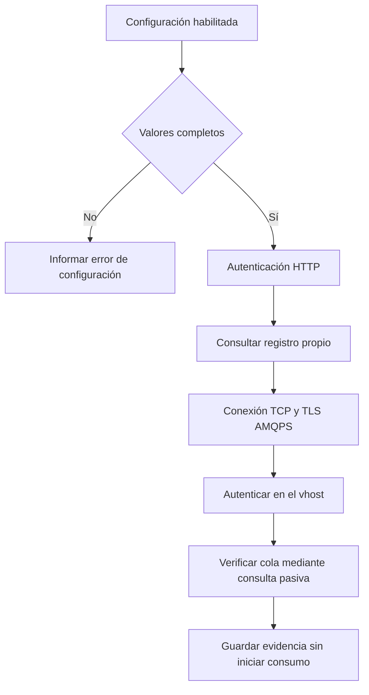

# Accesos y conexión con Core

Primer roadmap de la [secuencia de integración](README.md). Su objetivo es verificar que el backend puede autenticarse ante la API de Core y conectarse al broker por AMQPS. La publicación y el consumo reales se habilitan en el tercer roadmap, después de probar la entrega confiable.

Contrato de referencia: [comportamiento verificado en el ZIP de Core](00-contrato-core-verificado.md). Las tareas de código y pruebas locales pueden empezar mientras se gestionan los accesos; el cierre remoto requiere las verificaciones de C1 y C4.

Implementación disponible: [configuración y operación](../technical/core-integration.md). C2 está implementado; C3 dispone de clientes y verificaciones locales, pero sus consultas remotas y C1/C4 no se ejecutaron.

## C1 Reunir accesos y acordar el alcance técnico

- [x] Core confirmó `desarrollo-social` activo, cola `q.desarrollo-social` y usuario `module_desarrollo-social`.
- [x] Recibir el usuario y la contraseña AMQPS propios por canal privado; no incorporar la contraseña a Git.
- [ ] Obtener el secret de máquina propio para HTTP. Su ausencia no bloquea la comprobación AMQPS.
- [ ] Solicitar acceso humano al dashboard si lo requiere la prueba; esa cuenta no reemplaza las credenciales del backend.
- [ ] Identificar el entorno desde el que se conectará el backend y su IP pública de salida, indicando si es fija o variable.
- [x] Core comunicó la habilitación de `187.127.41.168/32` al 5671. Queda pendiente comprobar que sea la salida efectiva del despliegue y realizar la conexión.
- [ ] Acordar con Core el tipo técnico propuesto `socialCoreConnectivityProbe`, versión `1.0`, payload ficticio y horario. M8 será emisor y receptor mediante suscripción propia: el código permite este recorrido sin integrar otro módulo.
- [ ] Confirmar la versión desplegada contra el ZIP, comparando OpenAPI y el schema público del sobre; solicitar a Core el commit o imagen efectiva cuando sea posible.
- [ ] Confirmar que existe un worker externo o embebido consumiendo `core.inbox` y `q.dlq`. La respuesta de readiness no demuestra su actividad.
- [ ] Consultar con Core las suscripciones existentes y el tratamiento de posibles mensajes de negocio pendientes en la cola propia.

La credencial AMQPS y la confirmación de habilitación ya se recibieron. El primer despliegue puede comprobar TLS, autenticación y cola pasiva mediante `CORE_AMQP_CHECK_ON_STARTUP=true`, manteniendo publicación y consumo desactivados. El secret HTTP, la verificación desde la IP habilitada y el acuerdo del intercambio de eventos siguen pendientes. Los valores y logs esperados están en la [guía de despliegue](../technical/core-integration.md).

### Valores de referencia

| Parámetro | Valor indicado por la guía | Verificación pendiente |
| --- | --- | --- |
| Dashboard | <https://core-uade-2026.duckdns.org> | Cuenta humana y acceso vigente, si se utiliza. |
| Base HTTP | <https://core-uade-2026.duckdns.org/api/v1> | Disponibilidad y contrato vigente. |
| Readiness remoto | <https://core-uade-2026.duckdns.org/health/ready> | Respuesta desde el entorno real del backend. |
| Host AMQPS | `core-uade-2026.duckdns.org` | Resolución DNS y certificado. |
| Puerto | `5671` | Acceso TCP desde la IP habilitada. |
| Virtual host | `core` | Acceso del usuario entregado. |
| Exchange de publicación | `muni.inbox` | Permiso de publicación; administrado por Core. |
| Routing key | Cadena vacía | Conservarla sin sustituirla por el tipo de evento. |
| Cola prevista | `q.desarrollo-social` | Nombre efectivo y existencia mediante consulta pasiva. |

## C2 Agregar configuración aislada del backend

- [x] Incorporar `org.springframework.boot:spring-boot-starter-amqp`, sin versión explícita y administrado por el Spring Boot 4.0.7 del proyecto. Justificación: aporta conexión RabbitMQ, publicación confirmada y contenedor con ack manual; no cambia el stack ni requiere actualizar Boot.
- [x] Definir propiedades tipadas para Core siguiendo el patrón de `@ConfigurationProperties` existente.
- [x] Separar API base, identificador de módulo, secret de máquina, conexión AMQPS, cola propia, timeouts y habilitación de publicación y consumo.
- [x] Mantener la integración deshabilitada por defecto en desarrollo sin configurar, pruebas y perfil `docs`.
- [x] Validar los valores obligatorios cuando la integración esté habilitada. Una configuración inválida se distingue de una indisponibilidad temporal del Core.
- [x] Incorporar únicamente nombres y valores no sensibles a `.env.example`; los secretos se cargan en la configuración privada del backend.
- [x] Configurar TLS con verificación del certificado y hostname mediante el almacén de confianza. La conexión remota queda pendiente de prueba.
- [x] Desactivar la declaración automática de exchanges, colas y bindings. Core es propietario de la topología.

### Configuración a implementar

Mantener `app.core.enabled=false`, `app.core.publisher.enabled=false`, `app.core.consumer.enabled=false` y `app.core.probe.enabled=false` por defecto. `app.core` concentra API base, identidad de máquina, cola propia y parámetros de outbox; la conexión se configura con las propiedades `spring.rabbitmq` de la tabla. Las variables nuevas deben usar prefijo `CORE_` y documentarse en `.env.example` sin secretos.

| Propiedad Spring | Valor requerido |
| --- | --- |
| `spring.rabbitmq.host`, `port`, `virtual-host` | Dominio, `5671`, `core`, sujetos a ficha. |
| `spring.rabbitmq.username`, `password` | Credenciales AMQPS privadas. |
| `spring.rabbitmq.dynamic` | `false`. |
| `spring.rabbitmq.ssl.enabled` | `true` en AWS. |
| `spring.rabbitmq.ssl.validate-server-certificate` | `true`. |
| `spring.rabbitmq.ssl.verify-hostname` | `true`. |
| `spring.rabbitmq.publisher-confirm-type` | `correlated`. |
| `spring.rabbitmq.publisher-returns` | `true`. |
| `spring.rabbitmq.template.mandatory` | `true`. |
| `spring.rabbitmq.template.retry.enabled` | `false`; reintenta la outbox. |
| `spring.rabbitmq.listener.simple.acknowledge-mode` | `manual`. |
| `spring.rabbitmq.listener.simple.default-requeue-rejected` | `false`. |
| `spring.rabbitmq.listener.simple.retry.enabled` | `false`; gobierna Core. |
| `spring.rabbitmq.listener.simple.auto-startup` | `false` hasta habilitación explícita. |

El contenedor debe tener además `autoDeclare=false`, sin beans que declaren Queue, Exchange o Binding. Implementar una fábrica propia para ese ajuste. Usar `RabbitTemplate.send` con bytes JSON generados por el `JsonMapper` existente y un listener que reciba el mensaje AMQP crudo; no hace falta otro conversor Jackson.

La condición de habilitación debe cubrir connection factory, template, listener, scheduler e indicador de salud. Desactivar solo el listener no garantiza que la auto-configuración o Actuator no intenten una conexión. Verificar cero conexiones al iniciar con `app.core.enabled=false`.

Referencias oficiales: [AMQP en Spring Boot 4.0](https://docs.spring.io/spring-boot/4.0/reference/messaging/amqp.html), [propiedades de RabbitMQ](https://docs.spring.io/spring-boot/4.0/appendix/application-properties/index.html) y [configuración del contenedor Spring AMQP 4.0](https://docs.spring.io/spring-amqp/reference/4.0/amqp/containerAttributes.html). Verificar las APIs contra la versión efectivamente resuelta por Gradle, sin actualizar dependencias a la versión que muestre el sitio por defecto.

Archivos a revisar o extender: `build.gradle.kts`, `.env.example`, `src/main/resources/application.yml`, `src/main/resources/application-docs.yml` y `src/main/kotlin/com/uade/dda2/server/config/`.

El transporte documentado requiere HTTP y AMQPS. No exige incorporar un SDK de AWS ni claves de la cuenta AWS de Core. Los secretos de máquina se mantienen separados del JWT local y de las variables `VITE_*` del frontend.

## C3 Autenticar el cliente HTTP y consultar el registro

- [ ] Implementar el cliente con `RestClient`, disponible en Spring, y timeouts de conexión y lectura explícitos y configurables, sin otra dependencia HTTP. Usar API base terminada en `/api/v1` y rutas relativas como `/auth/module-token` para no duplicar el prefijo.
- [ ] Obtener el token con `POST /api/v1/auth/module-token`, enviando `module` y `secret`.
- [ ] Usar el `accessToken` como Bearer y solicitar otro según `expiresIn`; la guía no define refresh token.
- [ ] Deserializar los DTOs camelCase reales y verificar `module=desarrollo-social` y `kind=module` en la respuesta. Conservar token y vencimiento solo en memoria, sin reutilizar el secret del JWT local.
- [ ] Controlar la renovación concurrente y los reintentos para evitar múltiples solicitudes de token o ciclos ante un 401 persistente.
- [ ] Consultar `GET /api/v1/publications` y `GET /api/v1/subscriptions` con la identidad de máquina propia.
- [ ] Filtrar `publications` por `moduleName` porque el endpoint devuelve el mapa global; `subscriptions` ya está filtrado por Core. Consumir ambos como arrays y contrastar su `queueName` con la cola configurada.
- [ ] Consultar `GET /api/v1/event-types/{name}` para el tipo técnico y `GET /api/v1/events-meta/envelope-schema`; registrar dueño y schema efectivos. No confundir tipos, publicaciones y suscripciones.
- [ ] Documentar qué registros necesita la prueba y cuáles ya existen. No registrar todavía la lista completa de integraciones de negocio diferidas.
- [ ] Preparar una operación deliberada de registro, separada del arranque habitual de la aplicación.

Si hace falta registrar el contrato técnico, el orden es tipo propio con schema, publicación propia y suscripción propia. Usar los IDs reales devueltos para cualquier pausa posterior. Ante conflicto de registro concurrente, releer antes de modificar; no asumir que un 409 exige volver a crear todo.

Los POST de registro reutilizan entradas existentes, pero pueden reactivarlas y modificar `maxAttempts`. Un `201` no demuestra que el broker ya tenga la topología aplicada. No tratar esos POST como operaciones sin efectos ni repetirlos ciegamente en cada inicio.

## C4 Verificar AMQPS sin consumir mensajes

- [ ] Probar, desde el entorno que ejecutará el backend, DNS, TCP al 5671, TLS y autenticación contra el vhost.
- [ ] Comprobar pasivamente la existencia de la cola propia, sin crear recursos ni purgarla.
- [ ] Usar un canal diagnóstico separado para la declaración pasiva: una cola inexistente puede cerrar ese canal. `GET /topology` solo muestra el plan del registro; si falta la cola, Core debe aplicar la topología con sus permisos administrativos.
- [ ] Consultar `/health/ready` leyendo `status` y los checks del cuerpo, incluso cuando HTTP sea 200. Registrar aparte la comprobación de actividad del worker.
- [ ] Diferenciar errores de red, TLS, autenticación y permisos en el diagnóstico.
- [ ] Probar el comportamiento con la integración deshabilitada y con Core temporalmente inaccesible: la indisponibilidad remota no debe impedir las operaciones locales independientes.
- [ ] Verificar que los logs no incluyen contraseñas, secretos, tokens ni URLs con credenciales.

## Criterios de cierre

- [ ] La integración deshabilitada no intenta conectarse al Core.
- [ ] Las pruebas y la generación de OpenAPI no necesitan secretos ni acceso al ambiente compartido.
- [ ] Desde el backend desplegado se verificaron HTTP autenticado y AMQPS con TLS y permisos propios.
- [ ] La comprobación pasiva de la cola quedó registrada sin alterar su contenido ni topología.
- [ ] Los datos de la ficha privada y el contrato de prueba están confirmados; no se guardaron secretos en Git.

Siguiente paso: [mensajería confiable](02-core-mensajeria-confiable.md).
