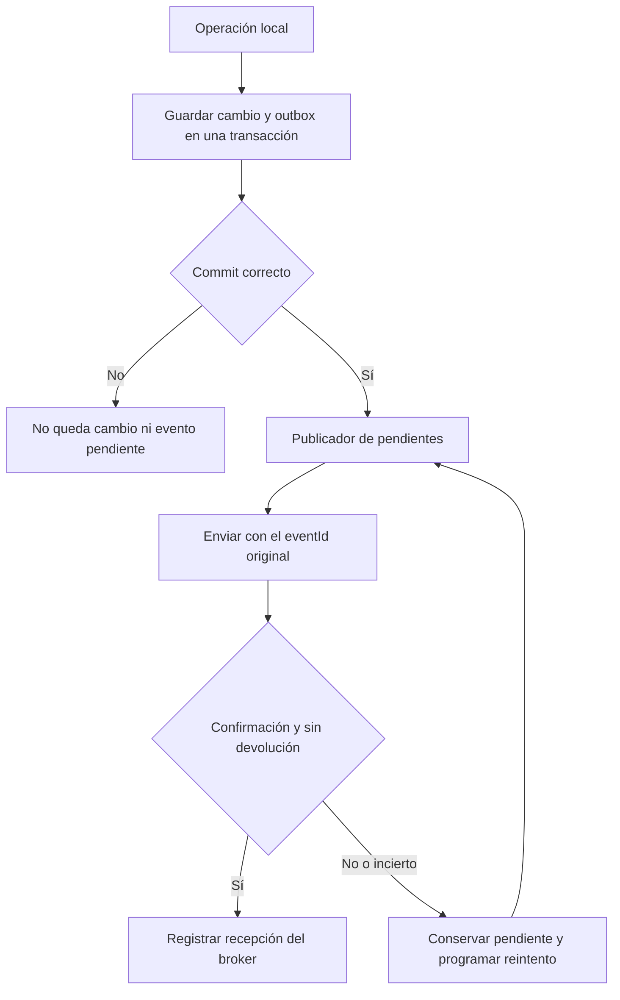

# Mensajería confiable con Core

Segundo roadmap de la [secuencia de integración](README.md). Implementa infraestructura reutilizable y la verifica en aislamiento. Depende de las decisiones de configuración del [primer roadmap](01-core-accesos-y-conexion.md); las pruebas locales pueden avanzar mientras se gestionan los accesos remotos.

La outbox guarda eventos pendientes de envío en nuestra base. La inbox registra eventos procesados para evitar efectos duplicados. Ambas están implementadas junto con los clientes y adaptadores de este roadmap; ver la [guía técnica](../technical/core-integration.md). Las pruebas locales no sustituyen las verificaciones pendientes sobre PostgreSQL real, broker real y AWS.

Los checklists siguientes conservan tareas que combinan implementación y pruebas de protocolo: no se marcan globalmente completas hasta cumplir ambas. El bloque local ya cuenta con pruebas de serialización, HTTP local, confirm/return controlados, transacciones, reservas y deduplicación en H2.

Aplicar el [contrato contrastado con Core](00-contrato-core-verificado.md): el broker confirma transporte, el registro de Core describe ingesta y ruteo, y la inbox local acredita nuestro procesamiento. Ninguno reemplaza a los otros.

## C5 Definir el sobre y los límites de la integración

- [ ] Crear un contrato compartido con `eventId` UUID, `eventType`, `eventVersion`, `occurredAt` con zona, `sourceModule` y `data` como objeto.
- [ ] Admitir `correlationId` y `causationId` UUID cuando correspondan al contrato.
- [ ] Validar nombres y versiones exactos, sin conversiones automáticas de mayúsculas, alias o identificadores de módulo.
- [ ] Usar `desarrollo-social` como origen propio, sujeto a la confirmación de la ficha privada.
- [ ] Mantener los datos del contrato dentro de `data`; no serializar entidades JPA como eventos.
- [ ] Rechazar campos extra en la raíz del sobre. Poner trazas en headers (`x-core-trace-id` al publicar por AMQP), no como `traceId` del JSON.
- [ ] Enviar `eventVersion` y `data` explícitos aunque Core tenga valores por defecto; utilizar DTOs con límites compatibles con `EventEnvelope`.
- [ ] Probar el manejo de fechas y JSON con Jackson 3 y Kotlin. Conservar el instante del hecho al retransmitir.
- [ ] Implementar un handler técnico exclusivamente para el contrato de prueba acordado. Los handlers de negocio permanecen diferidos.
- [ ] Despachar handlers por `(eventType, eventVersion)`. Core valida un único schema de `data` por nombre y no selecciona schema ni destinos por versión.

La edición V3 del documento de eventos no implica una `eventVersion` igual a `3`: los ejemplos usan `1.0`. La versión transmitida debe ser la acordada para cada contrato.

### Componentes que se implementarán

Raíz de los componentes nuevos: `src/main/kotlin/com/uade/dda2/server/`. Cada clase se mantiene en su archivo y los adaptadores dependen de servicios y contratos compartidos.

| Ubicación propuesta | Responsabilidad |
| --- | --- |
| `config/CoreProperties.kt` y `config/CoreAmqpConfiguration.kt` | Propiedades tipadas, condición de habilitación, factory, template y listener sin declaraciones activas. |
| `feature/integration/dto/` | Sobre de eventos, DTOs HTTP camelCase y payload de prueba; `JsonNode` para datos JSON genéricos. |
| `feature/integration/client/CoreTokenClient.kt` | Obtener y renovar el token con exclusión de renovaciones concurrentes. |
| `feature/integration/client/CoreRegistryClient.kt` | Consultas y registro deliberado propio. Sin escrituras automáticas al arrancar. |
| `feature/integration/client/CoreEventClient.kt` | Consultar estado por `eventId`, entregas y diagnóstico. No publicar por HTTP como fallback. |
| `feature/integration/entity/` y `repository/` | Outbox e inbox en la base local; reservas, unicidad y consultas operativas. |
| `feature/integration/service/CoreOutboxService.kt` | Guardar un evento en la transacción del llamador. |
| `feature/integration/service/CoreOutboxPublisher.kt` y `scheduler/` | Tomar pendientes, publicar fuera de la transacción de reserva y registrar confirms o reintentos. |
| `feature/integration/service/CoreInboxService.kt` | Transacción de deduplicación y ejecución del handler. |
| `feature/integration/messaging/CoreMessageListener.kt` | Recibir bytes y headers, invocar el servicio y efectuar ack después del commit. |
| `feature/integration/service/CoreProbeHandler.kt` | Verificar el contrato técnico y registrar la recepción mediante inbox, sin emitir respuesta ni modificar entidades de negocio. |

Los nombres son decisiones de organización local para esta implementación. La entrada del broker no invoca controladores HTTP ni simula un JWT de usuario. La configuración Spring y su dependencia AMQP están definidas en el [primer roadmap](01-core-accesos-y-conexion.md).

## C6 Persistir y publicar mediante outbox

- [ ] Crear `core_outbox` con `event_id` UUID único, sobre serializado inmutable, hash de contenido, tipo, versión, correlación, fecha del hecho, estado, intentos, próximo intento, reserva y último error técnico redactado.
- [ ] Utilizar estados locales `PENDING`, `IN_FLIGHT` y `BROKER_CONFIRMED`. Este último significa confirm positivo sin devolución; no significa aceptado por Core ni terminado por un destinatario.
- [ ] Preparar y revisar el cambio de esquema con restricciones e índices. Verificarlo en PostgreSQL desechable antes de aplicarlo en el entorno real.
- [ ] Proveer una operación para guardar un evento dentro de la misma transacción local del cambio que lo origina. Por ahora, verificarla con el caso técnico de prueba, sin conectar servicios de beneficios o solicitudes.
- [ ] Implementar un publicador de pendientes que soporte reinicios y concurrencia entre procesos sin enviar continuamente el mismo registro en paralelo.
- [ ] Reservar un lote en una transacción corta mediante locking de PostgreSQL y exclusión de filas tomadas (`SKIP LOCKED`), asignando token y vencimiento de reserva. Enviar fuera de esa transacción; aplicar el resultado solo si sigue vigente el token para no aceptar callbacks tardíos de un intento anterior.
- [ ] Recuperar reservas vencidas tras un reinicio conservando `eventId`. No prometer ausencia total de duplicados entre broker y base; nuestra inbox debe tolerarlos.
- [ ] Enviar JSON con `content_type=application/json`, persistencia, exchange `muni.inbox`, routing key vacía, publisher confirms y `mandatory`.
- [ ] Correlacionar confirms y devoluciones con el registro de salida. Un mensaje devuelto no puede quedar marcado como enviado correctamente aunque reciba un confirm del broker.
- [ ] Usar `CorrelationData` por intento con identidad local de envío distinta del UUID lógico. Con confirms y returns habilitados, revisar el resultado del confirm y la devolución asociada antes de pasar a `BROKER_CONFIRMED`.
- [ ] Reintentar las publicaciones fallidas o de resultado incierto con el mismo `eventId`, sobre y payload; un nuevo hecho genera otro identificador.
- [ ] Guardar los pendientes durante una caída de Core y reanudar el envío al recuperar conexión. Definir límites y alertas para intentos y antigüedad, sin descartar silenciosamente los eventos.
- [ ] Separar la finalización de transporte de la observación remota: un `REJECTED` o `NO_SUBSCRIBERS` en Core genera diagnóstico e intervención, no otra publicación automática que Core descartará como duplicada.

Confirmar recepción del broker no demuestra validación de Core ni procesamiento del destinatario. Los estados locales y la evidencia deben expresar esa diferencia. El reintento de nuestra outbox resuelve el envío al broker; los reintentos administrados por Core resuelven entregas rechazadas por consumidores.

El esquema se mantendrá con entidades JPA y un script SQL revisable en `docs/database/`, sin agregar por esta tarea un framework de migraciones. El script y sus restricciones se verifican sobre una base desechable antes de su aplicación deliberada en el entorno real. No depender únicamente del `ddl-auto=update` para habilitar esa base.

Referencia del cliente: [confirms correlacionados y devoluciones en Spring AMQP 4.0](https://docs.spring.io/spring-amqp/reference/4.0/amqp/template.html).

## C7 Procesar e identificar duplicados mediante inbox

- [ ] Crear `core_inbox` con `event_id` UUID único, hash del sobre lógico, tipo, versión, origen, correlación, fechas de recepción/procesamiento y metadatos de transporte necesarios para diagnóstico. No persistir por defecto payloads completos de ciudadanos; el contrato técnico usa datos ficticios.
- [ ] Validar el sobre y despachar únicamente contratos con handler habilitado.
- [ ] Resolver la deduplicación con inserción atómica por UUID en PostgreSQL (`ON CONFLICT DO NOTHING`) dentro de la transacción del procesamiento. Si el evento ya existe, contrastar su hash; un mismo UUID con contenido distinto es un error, no un duplicado correcto. Usar JSON normalizado con orden determinista para que el orden de claves no cambie la huella.
- [ ] Guardar el resultado del handler y el registro de procesamiento en la misma transacción local.
- [ ] Ejecutar `ack` después del commit. Un duplicado ya procesado se confirma sin repetir sus efectos.
- [ ] Mantener la transacción en un servicio Spring separado del listener, para que su retorno exitoso implique commit antes del ack. Si falla el ack después del commit, conservar la inbox y permitir que la redelivery se deduplique; no volver a ejecutar el efecto ni simular un error de negocio.
- [ ] Ante rollback o fallo de procesamiento, usar `nack/reject` con `requeue=false` según el flujo acordado con Core.
- [ ] Tratar contrato inesperado, versión no soportada o contenido conflictivo como fallo observable con rechazo sin requeue; no registrar procesamiento exitoso ni emitir respuesta genérica. Antes de consumir remotamente, resolver las suscripciones de negocio existentes para no agotar sus entregas sin handler.
- [ ] Leer el cuerpo como sobre canónico directo. Conservar `message_id`, `x-core-event-id`, `x-core-target-module`, `x-core-attempt` y `x-core-trace-id` para diagnóstico; no usarlos para autorizar usuarios.
- [ ] Evitar `requeue=true` como estrategia automática y no implementar consumidores de las DLQ de infraestructura.
- [ ] Separar la idempotencia del transporte de las futuras reglas de orden de cada entidad. Un UUID no ordena los hechos y `occurredAt` no constituye una secuencia de negocio universal.
- [ ] Ante fallo, rechazar la entrega original, sin republicar el mensaje ni añadir headers de retry. Core obtiene los identificadores del cuerpo y de sus headers para correlacionar la dead letter; el detalle local del error queda en nuestros logs redactados.

La guía advierte que `sourceModule` no está vinculado técnicamente al usuario RabbitMQ que publicó. Validar su valor esperado sirve al contrato, pero no demuestra identidad de un ciudadano ni habilita acciones privilegiadas.

## C8 Verificar fallos en un entorno aislado

Preparar un broker y una base desechables de prueba, sin conectarse al ambiente compartido. La creación de recursos de ese entorno pertenece a la configuración de pruebas; no habilita declaraciones automáticas contra Core.

Usar servicios desechables RabbitMQ y PostgreSQL para los escenarios de protocolo y transacciones; mocks o el broker `memory://` del Core no prueban TTL, TLS, permisos o redelivery reales. Las pruebas unitarias de DTOs y clientes HTTP siguen sin requerir broker. La ejecución del Core del ZIP, si se incorpora a un fixture local, debe aislar su seed y credenciales del proyecto y nunca apuntar a AWS.

| Escenario | Resultado que debe verificarse |
| --- | --- |
| Rollback de la operación local | No persiste el cambio ni su evento de salida. |
| Broker inaccesible | El evento permanece pendiente y se recupera luego. |
| Publicación devuelta con confirm positivo | No se considera un envío correcto. |
| Timeout o desconexión durante el envío | La retransmisión conserva `eventId` y contenido. |
| Dos publicadores concurrentes | Hay control de toma de pendientes y deduplicación tolerante a entregas repetidas. |
| Mismo evento recibido dos veces | Un solo efecto local. |
| Mismo evento recibido concurrentemente | La restricción y la transacción impiden el efecto duplicado. |
| Mismo UUID con distinto contenido | Conflicto observable; no se repite ni reemplaza el efecto original. |
| Reinicio después del commit y antes del ack | La redelivery se confirma sin repetir efectos. |
| Fallo del handler | Rollback y rechazo según la política acordada. |
| Versión no soportada | Error observable y tratamiento explícito, sin bucle automático. |
| JSON con campos extra en la raíz o fecha sin zona | Rechazo compatible con el sobre de Core. |
| Respuesta de token o registro camelCase | DTO correcto, filtrado de publicaciones propias y renovación de token acotada. |
| Integración deshabilitada | Ningún scheduler, health check ni factory intenta conectarse. |

Separar dos verificaciones de duplicados: reenviar al ingreso de Core prueba su deduplicación, pero no vuelve a alcanzar nuestra inbox. Para comprobar nuestra idempotencia se fuerza redelivery antes del ack en aislamiento, o se coordina una reentrega administrativa real en la etapa remota.

## Criterios de cierre

- [ ] Los contratos y adaptadores compilan sin introducir dependencias incompatibles con el stack existente.
- [ ] Las pruebas de atomicidad, duplicados, concurrencia y recuperación pasan en aislamiento.
- [ ] Se verificaron restricciones y persistencia sobre PostgreSQL desechable, además de las pruebas unitarias aplicables.
- [ ] Los estados de envío no confunden recepción del broker con finalización del negocio.
- [ ] No hay integración de negocio activada ni consumo remoto de contratos sin handler.

Siguiente paso: [prueba coordinada y habilitación](03-core-prueba-y-habilitacion.md).
