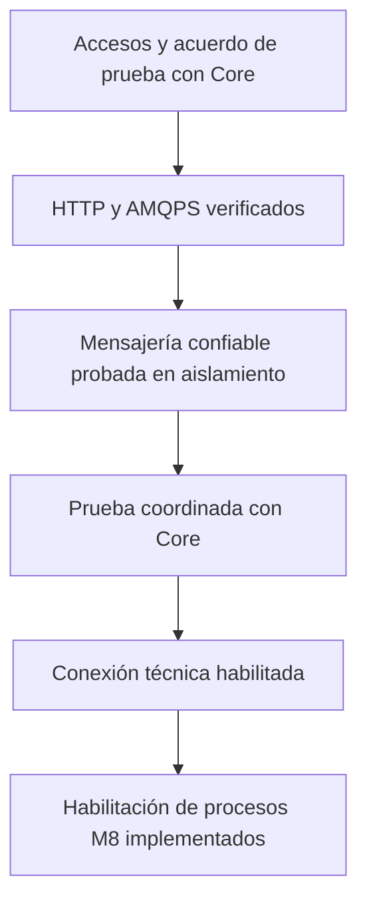

# Roadmaps de integración con Core

El primer objetivo es conectar el backend de Desarrollo Social con Core y verificar publicación y consumo confiables. El equipo amplió el alcance y autorizó los contratos y procesos de negocio con Ciudadanos, Atención Ciudadana y Rentas; están implementados con activación independiente. La habilitación remota conserva sus requisitos y evidencia.

Estado al 2 de noviembre de 2026: infraestructura técnica y dashboard de integración implementados, con 33 pruebas locales aprobadas e integración desactivada por defecto. Cliente HTTP, adaptadores AMQP, outbox, inbox y prueba remota opt-in están disponibles. El despliegue ya confirmó conexión AMQPS con TLS, autenticación y consulta pasiva de `q.desarrollo-social`; también inició correctamente la conexión PostgreSQL/JPA. Core confirmó la entrega del secreto HTTP rotado: falta configurarlo y comprobarlo desde nuestro despliegue. El intercambio real de eventos sigue pendiente.

La [evidencia registrada](evidencias-core.md) distingue lo implementado, lo probado localmente y lo verificado en el despliegue. La [guía técnica](../technical/core-integration.md) documenta variables, arranque y diagnóstico. La contraseña permanece en el entorno privado, fuera de Git.

La [etapa de negocio M8](04-integraciones-posteriores.md) y [su guía técnica](../technical/m8-events.md) agregan los diez contratos, procesos, endpoints administrativos y AsyncAPI; requieren migración y verificación con las contrapartes antes de habilitarse.

## Avance actual

| Hito | Estado |
| --- | --- |
| C1 Accesos y acuerdos | AMQPS verificado y entrega del secreto HTTP rotado confirmada; pendientes configuración HTTP, acuerdos de prueba y datos operativos. |
| C2 Configuración | Implementada y comprobación AMQPS de arranque verificada en el despliegue. |
| C3 Cliente HTTP | Implementado y probado localmente; dashboard protegido de siete endpoints disponible. Autenticación y consultas remotas pendientes. |
| C4 Conectividad | AMQPS y cola pasiva verificadas; readiness, worker y prueba de caída real pendientes. |
| C5–C7 Sobre, outbox e inbox | Implementados y con pruebas locales. Persistencia funcional sobre PostgreSQL real y protocolo RabbitMQ pendientes. |
| C8 Fallos en aislamiento | 33 pruebas locales aprobadas, incluidas autorización y consultas del dashboard; escenarios con servicios desechables pendientes. |
| C9–C11 Intercambio y recuperación | Driver opt-in preparado; recorrido real y recuperación pendientes. |
| C12 CI y operación | Compilación, pruebas locales, OpenAPI y guía completados; CI técnico, cobertura y acuerdos operativos pendientes. |

En los checklists, `[x]` indica completado dentro del alcance descrito: implementación, prueba local o comprobación remota. Las pruebas remotas se listan por separado para no confundirlas con código disponible.

## Orden de ejecución

| Orden | Roadmap | Resultado esperado |
| --- | --- | --- |
| Referencia | [Contrato verificado contra Core](00-contrato-core-verificado.md) | Endpoints, sobre, ruteo, headers, estados y limitaciones del snapshot aportado. |
| 1 | [Accesos y conexión con Core](01-core-accesos-y-conexion.md) | Configuración aislada, autenticación HTTP y conexión AMQPS verificadas, sin modificar la topología. |
| 2 | [Mensajería confiable](02-core-mensajeria-confiable.md) | Sobre común, outbox, inbox, publicación confirmada y consumo idempotente probados en un entorno aislado. |
| 3 | [Prueba coordinada y habilitación](03-core-prueba-y-habilitacion.md) | Publicación y recepción verificadas con Core, con evidencia y recuperación ante fallos. |
| 4 | [Procesos de negocio M8](04-integraciones-posteriores.md) | Contratos, procesos y AsyncAPI implementados; migración, compatibilidad y habilitación externa pendientes. |

## Alcance de esta fase

- Configuración del backend y separación de sus credenciales de las de usuarios finales.
- Cliente HTTP para autenticación de máquina y operaciones de registro autorizadas.
- Conexión AMQPS a la topología administrada por Core.
- Contrato técnico del sobre de eventos, publicación y consumo confiables.
- Persistencia de eventos pendientes y procesados, diagnóstico y pruebas.
- Verificación de un intercambio técnico cuyo tipo, payload y participantes acuerde Core.

La prueba definida es una publicación y suscripción propias al tipo técnico propuesto `socialCoreConnectivityProbe`, con versión `1.0`. El código de Core permite entregar al propio emisor, sin implementar otro módulo ni un servicio de eco. El nombre y la habilitación remota deben acordarse con Core; el payload y los pasos están definidos en el [tercer roadmap](03-core-prueba-y-habilitacion.md).

Quedan para después el login externo, la sincronización de ciudadanos, las gestiones derivadas, los documentos externos, las exenciones, los efectos sobre beneficios y sus pantallas. Conectar Core no implica que esos flujos estén integrados.

## Punto de partida antes de implementar

| Área | Estado observado | Consecuencia para el plan |
| --- | --- | --- |
| Backend | Kotlin 2.2.21, Spring Boot 4.0.7 y Java 17. | Conservar el stack y justificar la dependencia AMQP antes de incorporarla. |
| JSON | Jackson 3 con soporte Kotlin. | Verificar la compatibilidad del cliente y la serialización elegidos. |
| Persistencia | JPA y PostgreSQL; `ddl-auto` configurable, con `update` por defecto. | Preparar y revisar los cambios de esquema de outbox e inbox sobre una base desechable. |
| Arquitectura | Funcionalidades con servicios, repositorios, entidades, DTOs y validadores. | Agregar la integración siguiendo esa organización. |
| Mensajería | Sin cliente AMQP, outbox, inbox ni consumidor de Core. | Implementar la infraestructura antes de enlazar acciones de negocio. |
| Autenticación | JWT local, Bearer y cookies de sesión. | El token de máquina de Core necesita un cliente y ciclo de vida separados. |
| CI del backend | El workflow principal ejecuta `assemble`. | Incorporar pruebas de integración técnica en la habilitación. |

## Reglas para ejecutar los roadmaps

- Mantener cada hito pendiente hasta guardar su evidencia. Compilar no demuestra conectividad ni procesamiento remoto.
- Distinguir lo probado en aislamiento de lo verificado contra Core.
- Desarrollar y ejecutar pruebas locales sin depender de los secretos del ambiente compartido.
- Mantener desactivado el consumo remoto hasta acordar los eventos de prueba y comprobar las suscripciones y los mensajes pendientes de la cola propia.
- Contrastar las rutas, clases, variables y tablas con el código y la guía técnica; los hitos pendientes pueden incluir propuestas todavía sin implementar.
- Resolver los pendientes externos de cada hito antes de ejecutar la parte que depende de ellos. Los procesos de negocio requieren además cumplir la [etapa M8](04-integraciones-posteriores.md).

## Bloque técnico implementado

Ese bloque ya está implementado: Spring AMQP con JSON de Jackson 3, cliente HTTP de máquina, configuración condicional, outbox e inbox locales, y handler de recepción técnica sin respuesta automática. Los [criterios técnicos](00-contrato-core-verificado.md) definen sus límites. Los checklists distinguen implementación local de habilitación y pruebas reales.

La conexión AMQPS ya tiene evidencia del despliegue. Para intercambiar eventos siguen pendientes configurar y comprobar el acceso HTTP recibido, registrar la IP de salida y la versión desplegada, consultar suscripciones y backlog efectivos, y acordar el tipo técnico y las pruebas de fallo. La [guía del dashboard](../technical/core-dashboard.md) permite comprobar HTTP desde nuestro backend sin entregar credenciales de máquina al navegador. La prueba opt-in prevista utiliza una base técnica desechable de M8 y no toca su base de negocio.

## Fuentes y precedencia

Para negocio prevalecen el contrato final M8 y M2 v1.79, junto con las decisiones expresas del equipo sobre vinculación, CLOSED por fallecimiento y finalización de ACTIVE/SUSPENDED. Las fuentes históricas siguientes conservan contexto técnico, sin imponer los nombres preliminares sobre los contratos finales.

1. Decisiones del equipo: primero Core; posteriormente se autorizó implementar también todos los procesos de negocio. Se exige vinculación M1 para publicar; fallecimiento cierra con CLOSED y finaliza ACTIVE y SUSPENDED.
2. `Contrato de eventos M8 para backend.pdf` y `Eventos M2 - V1.79.docx`: contrato funcional vigente, nombres finales y reglas de payloads.
3. Código y configuración actuales de Desarrollo Social, junto con las pruebas locales registradas.
4. `core_desappsii-main.zip`: snapshot técnico inspeccionado. La [referencia verificada](00-contrato-core-verificado.md) registra hash, rutas y límites; no acredita la versión desplegada de Core.
5. `Core — Guía común de integración AWS.docx` y confirmaciones de Core: transporte y operación, sujetos a comprobación en el despliegue.
6. Lista editada inicial y `EventosConEnvelopeM8.pdf`, V2 y V3: antecedentes; reemplazados por el contrato final en lo que difieran.
7. `TPO - Desarrollo de Apps II - Gestión de municipalidad.pdf`: arquitectura, independencia de datos, idempotencia y tolerancia a fallos.

Los documentos originales fueron aportados fuera del repositorio. Sus secretos no forman parte de estos roadmaps. La guía de Core es un borrador: sus valores deben contrastarse con la ficha privada y la habilitación efectiva del módulo.
