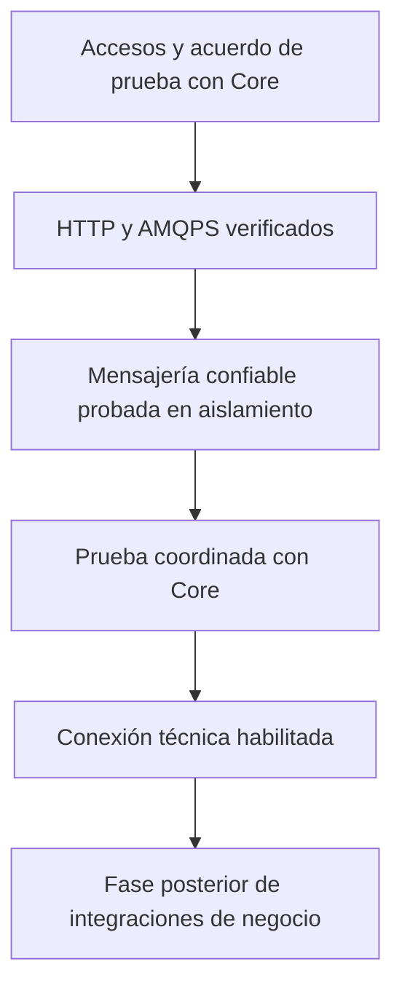

# Roadmaps de integración con Core

El primer objetivo es conectar el backend de Desarrollo Social con Core y verificar publicación y consumo confiables. Las integraciones de negocio con Ciudadanos, Atención Ciudadana y Rentas quedan para una fase posterior, por indicación del equipo.

Estado al 2 de noviembre de 2026: infraestructura técnica implementada con integración desactivada por defecto y verificaciones locales. Cliente HTTP, adaptadores AMQP, outbox, inbox y prueba remota opt-in están disponibles. No se verificaron accesos, PostgreSQL/broker reales ni conectividad AWS. Los criterios remotos siguen pendientes; los detalles de configuración y verificación están en la [guía técnica](../technical/core-integration.md).

Core ya comunicó la credencial AMQPS propia y la habilitación de `187.127.41.168/32`. Se agregó una comprobación pasiva de conexión al arrancar, opt-in, con marcador `CORE_AMQP_CONNECTED`. El usuario realizará el despliegue; el acceso HTTP y la prueba real siguen pendientes. La contraseña se carga en el entorno privado, fuera de Git.

## Orden de ejecución

| Orden | Roadmap | Resultado esperado |
| --- | --- | --- |
| Referencia | [Contrato verificado contra Core](00-contrato-core-verificado.md) | Endpoints, sobre, ruteo, headers, estados y limitaciones del snapshot aportado. |
| 1 | [Accesos y conexión con Core](01-core-accesos-y-conexion.md) | Configuración aislada, autenticación HTTP y conexión AMQPS verificadas, sin modificar la topología. |
| 2 | [Mensajería confiable](02-core-mensajeria-confiable.md) | Sobre común, outbox, inbox, publicación confirmada y consumo idempotente probados en un entorno aislado. |
| 3 | [Prueba coordinada y habilitación](03-core-prueba-y-habilitacion.md) | Publicación y recepción verificadas con Core, con evidencia y recuperación ante fallos. |
| Después | [Integraciones de negocio pendientes](04-integraciones-posteriores.md) | Alcance conservado para otra fase; sus contratos no bloquean el desarrollo de la infraestructura genérica. |

## Alcance de esta fase

- Configuración del backend y separación de sus credenciales de las de usuarios finales.
- Cliente HTTP para autenticación de máquina y operaciones de registro autorizadas.
- Conexión AMQPS a la topología administrada por Core.
- Contrato técnico del sobre de eventos, publicación y consumo confiables.
- Persistencia de eventos pendientes y procesados, diagnóstico y pruebas.
- Verificación de un intercambio técnico cuyo tipo, payload y participantes acuerde Core.

La prueba definida es una publicación y suscripción propias al tipo técnico propuesto `socialCoreConnectivityProbe`, con versión `1.0`. El código de Core permite entregar al propio emisor, sin implementar otro módulo ni un servicio de eco. El nombre y la habilitación remota deben acordarse con Core; el payload y los pasos están definidos en el [tercer roadmap](03-core-prueba-y-habilitacion.md).

Quedan para después el login externo, la sincronización de ciudadanos, las gestiones derivadas, los documentos externos, las exenciones, los efectos sobre beneficios y sus pantallas. Conectar Core no implica que esos flujos estén integrados.

## Punto de partida antes de implementar

| Área | Estado observado | Consecuencia para el plan |
| --- | --- | --- |
| Backend | Kotlin 2.2.21, Spring Boot 4.0.7 y Java 17. | Conservar el stack y justificar la dependencia AMQP antes de incorporarla. |
| JSON | Jackson 3 con soporte Kotlin. | Verificar la compatibilidad del cliente y la serialización elegidos. |
| Persistencia | JPA y PostgreSQL; `ddl-auto` configurable, con `update` por defecto. | Preparar y revisar los cambios de esquema de outbox e inbox sobre una base desechable. |
| Arquitectura | Funcionalidades con servicios, repositorios, entidades, DTOs y validadores. | Agregar la integración siguiendo esa organización. |
| Mensajería | Sin cliente AMQP, outbox, inbox ni consumidor de Core. | Implementar la infraestructura antes de enlazar acciones de negocio. |
| Autenticación | JWT local, Bearer y cookies de sesión. | El token de máquina de Core necesita un cliente y ciclo de vida separados. |
| CI del backend | El workflow principal ejecuta `assemble`. | Incorporar pruebas de integración técnica en la habilitación. |

## Reglas para ejecutar los roadmaps

- Mantener cada hito pendiente hasta guardar su evidencia. Compilar no demuestra conectividad ni procesamiento remoto.
- Distinguir lo probado en aislamiento de lo verificado contra Core.
- Desarrollar y ejecutar pruebas locales sin depender de los secretos del ambiente compartido.
- Mantener desactivado el consumo remoto hasta acordar los eventos de prueba y comprobar las suscripciones y los mensajes pendientes de la cola propia.
- Contrastar las rutas, clases, variables y tablas con el código y la guía técnica; los hitos pendientes pueden incluir propuestas todavía sin implementar.
- Resolver los pendientes externos de cada hito antes de ejecutar la parte que depende de ellos. Los contratos de negocio posteriores permanecen diferidos.

## Bloque técnico implementado

Ese bloque ya está implementado: Spring AMQP con JSON de Jackson 3, cliente HTTP de máquina, configuración condicional, outbox e inbox locales, y handler de recepción técnica sin respuesta automática. Los [criterios técnicos](00-contrato-core-verificado.md) definen sus límites. Los checklists distinguen implementación local de habilitación y pruebas reales.

Para el tráfico real siguen pendientes el acceso HTTP, la comprobación de la IP de salida y de los accesos AMQPS recibidos, la versión desplegada, las suscripciones y el backlog efectivos, y el acuerdo del tipo técnico y de las pruebas de fallo. Esos datos no se inventan ni se deducen del seed. La prueba opt-in prevista utiliza una base técnica desechable de M8 y no toca su base de negocio.

## Fuentes y precedencia

1. Instrucción del equipo: comenzar por Core y realizar las otras integraciones más adelante.
2. Lista editada de eventos aportada por el equipo: alcance previsto de publicaciones y suscripciones de negocio.
3. `core_desappsii-main.zip`: implementación técnica inspeccionada. La [referencia verificada](00-contrato-core-verificado.md) registra el hash del archivo y las rutas y símbolos que sustentan los ajustes. El comportamiento implementado prevalece sobre comentarios o ejemplos desactualizados del propio ZIP, sin asumir que sea la versión desplegada.
4. `Core — Guía común de integración AWS.docx`, borrador del 20 de octubre de 2026: valores públicos y restricciones operativas del ambiente AWS, sujetos a confirmación de Core.
5. `EventosConEnvelopeM8.pdf`, `EventosConEnvelopeM8V2.pdf` y `EventosConEnvelopeM8V3.pdf`: ejemplos de payloads y evolución de reglas. Las diferencias con la lista editada y el seed del ZIP se conservan en el [backlog posterior](04-integraciones-posteriores.md).
6. `TPO - Desarrollo de Apps II - Gestión de municipalidad.pdf`: arquitectura, independencia de datos, idempotencia, trazabilidad y tolerancia a fallos.
7. Código y configuración de Desarrollo Social revisados al preparar estos documentos.

Los documentos originales fueron aportados fuera del repositorio. Sus secretos no forman parte de estos roadmaps. La guía de Core es un borrador: sus valores deben contrastarse con la ficha privada y la habilitación efectiva del módulo.
