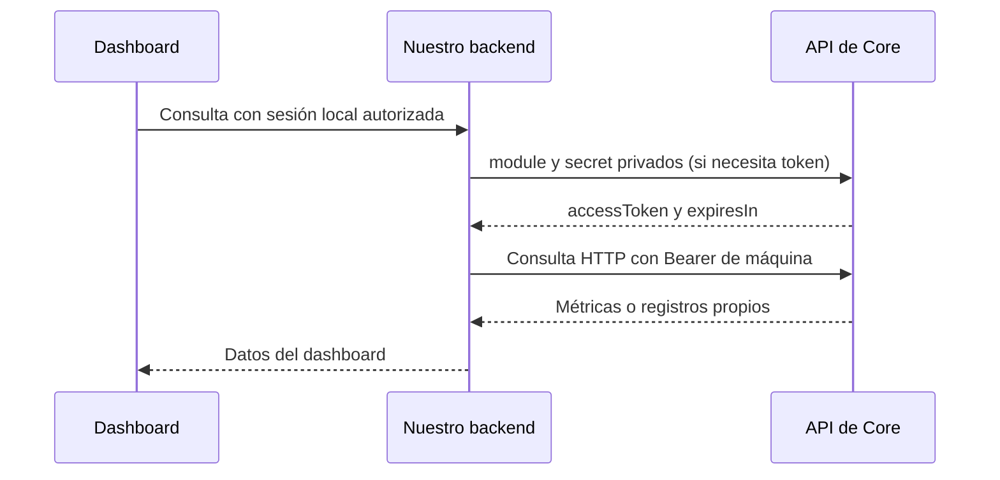

# Dashboard de integración con Core

Los endpoints de monitoreo consultan Core con la identidad de máquina de Desarrollo Social. La sesión del navegador sigue siendo la de nuestro backend. El secret de máquina y el token remoto no se envían al cliente.



## Configurar y comprobar el acceso HTTP

Core confirmó la entrega y rotación del secreto HTTP propio. El texto de la entrega contiene un placeholder; el valor real se toma del archivo privado recibido. Ese **secret** es la configuración persistente; `accessToken` es el token temporal que obtiene y renueva el backend.

Agregar al entorno privado del contenedor, conservando las variables AMQPS ya verificadas:

```dotenv
CORE_ENABLED=true
CORE_API_BASE_URL=https://core-uade-2026.duckdns.org/api/v1
CORE_MACHINE_SECRET=REEMPLAZAR_CON_EL_SECRET_HTTP_ROTADO_DEL_ARCHIVO_PRIVADO
CORE_AMQP_CHECK_ON_STARTUP=true
CORE_PUBLISHER_ENABLED=false
CORE_CONSUMER_ENABLED=false
CORE_PROBE_ENABLED=false
```

Recrear el contenedor para aplicar el entorno. No cargar aquí la contraseña RabbitMQ ni un `accessToken` temporal. `CoreTokenClient` solicita el token por `POST /auth/module-token`, lo conserva en memoria y utiliza `expiresIn` con margen de renovación; no asume una duración fija ni utiliza refresh token.

1. Desplegar la imagen que incluye estos endpoints y la configuración privada.
2. Iniciar una sesión nueva en nuestro backend y seleccionar el rol `ADMIN`. El nuevo JWT debe incluir `integrations:core:view`.
3. En Swagger (`/swagger-ui` por defecto), autorizar con ese JWT local y ejecutar `GET /api/admin/integrations/core/status`.
4. Comprobar **`http.state=UP` y `http.upstreamStatus=200`**. Esto acredita token válido y acceso autenticado al dashboard del módulo. `amqp.state=UP` acredita conexión y consulta pasiva de la cola.
5. Ejecutar `/dashboard`, `/publications`, `/subscriptions` y `/events` para revisar métricas y registros propios.

Fragmento del resultado esperado de `/status`:

```json
{
  "module": "desarrollo-social",
  "enabled": true,
  "machineSecretConfigured": true,
  "publisherEnabled": false,
  "consumerEnabled": false,
  "http": { "state": "UP", "upstreamStatus": 200 },
  "amqp": { "state": "UP", "queue": "q.desarrollo-social", "pendingMessages": 0, "activeConsumers": 0 }
}
```

El resultado incluye además `checkedAt` y campos de diagnóstico opcionales. Los contadores de cola son observaciones del instante; no se exige que sean cero para la consulta de estado.

`/status` devuelve HTTP local 200 aunque un transporte esté `DOWN`, `DISABLED` o `NOT_CONFIGURED`; hay que leer el cuerpo. El chequeo HTTP hace un GET autenticado al dashboard, y el chequeo AMQPS una declaración **pasiva** en un canal separado. No publica, consume, purga ni configura recursos. Es una consulta activa con timeouts, no una señal continua de salud ni una prueba de actividad del worker.

Al invocar `/status` también se registra:

```text
CORE_HTTP_CONNECTED module=desarrollo-social endpoint=/dashboard
```

Ante fallo: `CORE_HTTP_CONNECTION_FAILED module=desarrollo-social upstreamStatus=<HTTP remoto o null> code=<código>`. El log HTTP aparece al consultar el endpoint, no automáticamente al arrancar. El chequeo AMQPS de arranque conserva su marcador `CORE_AMQP_CONNECTED`.

## Contrato de endpoints

Base: `/api/admin/integrations/core`. Todos requieren autenticación local y `integrations:core:view` en el rol activo. Se comprueba también que el usuario siga activo, conserve el rol y su permiso actual. Las consultas de red se realizan después de terminar la transacción de autorización.

| Método y ruta | Resultado |
| --- | --- |
| `GET /status` | Estado HTTP y AMQPS, flags efectivos y diagnóstico. Funciona con Core desactivado sin intentar conectar. |
| `GET /dashboard?windowHours=24` | Métricas remotas del módulo más contadores locales. Ventana admitida: 1–720 horas. |
| `GET /metrics` | Contadores locales de outbox/inbox y fecha del pendiente sin confirmar más antiguo. No consulta Core y funciona con la integración desactivada. |
| `GET /publications` | Publicaciones declaradas de `desarrollo-social`; filtra el mapa global de Core. |
| `GET /subscriptions` | Suscripciones propias, cola, estado y `maxAttempts`. |
| `GET /events?page=1&size=25` | Listado remoto de eventos visibles para el módulo, sin payloads. `page` comienza en 1; `size`: 1–200. |
| `GET /events/{eventId}` | Detalle del UUID lógico del evento, sobre y entregas. Puede contener información del trámite; requiere el mismo permiso específico. |

Filtros opcionales del listado: `eventType` (1–120 caracteres), `status` (`ROUTED`, `NO_SUBSCRIBERS`, `REJECTED`, `DUPLICATE`) y `correlationId` UUID. Las consultas se codifican como parámetros; no permiten cambiar la URL o la identidad de máquina. La visibilidad de eventos la aplica Core en el servidor.

La página devuelve `items`, `total`, `page`, `size` y `pages`. El detalle utiliza `eventId`, no el `id` interno del listado. No se exponen operaciones de publicación, registro, toggle, retry, purga o consumo desde este controller.

## Interpretación de métricas y errores

`/dashboard` devuelve `core` y `local` separados. Core conserva su semántica: publicaciones `total` acumuladas e `inWindow` por ventana, entregas por estado, dead letters abiertas, registros y volumen por hora. `published.topTypes` utiliza la visibilidad del módulo de Core, que puede incluir tráfico recibido. No interpretar todas las cifras como limitadas por `windowHours`.

Los contadores locales son acumulados: `pending`, `inFlight`, `brokerConfirmed`, `inboxProcessed` y `oldestUnconfirmedAt` (mínimo entre `PENDING` e `IN_FLIGHT`). No devuelven payloads. La conexión JPA del despliegue anterior no prueba su comportamiento funcional contra PostgreSQL real; las pruebas locales de estos contadores usan H2.

`DELIVERED` de Core indica transporte a la cola; `BROKER_CONFIRMED` local indica confirm del broker sin devolución. La inbox acredita procesamiento local. Ninguno de esos estados debe presentarse como una aprobación de negocio.

| Resultado | Acción |
| --- | --- |
| HTTP local 401/403 | Revisar sesión, rol activo, permiso y estado actual del usuario en nuestro backend. |
| `http.state=NOT_CONFIGURED` | Falta `CORE_MACHINE_SECRET` en el proceso del backend. |
| `http.state=DOWN` | Revisar `upstreamStatus`, `code` y `traceId` cuando estén disponibles. Compartir esos datos con Core. |
| HTTP local 502 | Core rechazó la solicitud o devolvió un contrato inesperado. El error conserva código y, en el mensaje, HTTP remoto cuando corresponde. Un 401 remoto no invalida la sesión local. |
| HTTP local 503 | Integración desactivada, secreto ausente, fallo de transporte o cliente no disponible. |
| HTTP local 404 al consultar un evento | Evento inexistente, aún no ingerido o no visible para el módulo. |
| Métricas en cero o lista de eventos vacía | Puede ser correcto antes del primer intercambio; no implica por sí solo un fallo de autenticación. |

Si `BOOTSTRAP_ADMIN_ENABLED=true`, el inicializador registra el permiso y lo agrega a `ADMIN`. Cuando está desactivado, aplicar deliberadamente [la migración de permiso](../database/migrations/2026-11-02-core-dashboard-permission.sql), sin ejecutar los seeds de prueba. Volver a iniciar sesión después para obtener el permiso en el JWT. Otros roles se habilitan mediante la administración existente del proyecto.

## Verificación y alcance

```bash
./gradlew test --tests 'com.uade.dda2.server.feature.integration.*' bootJar generateOpenApiDocs --no-daemon
```

Las pruebas cubren autenticación, autorización y revocación, configuración desactivada, comprobaciones parciales y fallidas, métricas en H2, filtros, lectura de registros y eventos, traducción de errores, token cacheado y contrato HTTP local del dashboard. OpenAPI comprueba la presencia y seguridad de las siete rutas. No se agregaron dependencias.

El acceso HTTP desde el despliegue queda pendiente de configurar el valor privado y ejecutar `/status`. La entrega de una credencial no acredita esa prueba. El recorrido real de publicación, procesamiento y recepción de eventos sigue separado en el [roadmap de habilitación](../roadmaps/03-core-prueba-y-habilitacion.md).


El estado también incluye `businessEnabled`, para distinguir la activación de los procesos M8 de los dos transportes. Los nuevos recursos administrativos de tickets, entregas documentales, Rentas y alertas se describen en [eventos M8](m8-events.md) y usan sus propios permisos.
