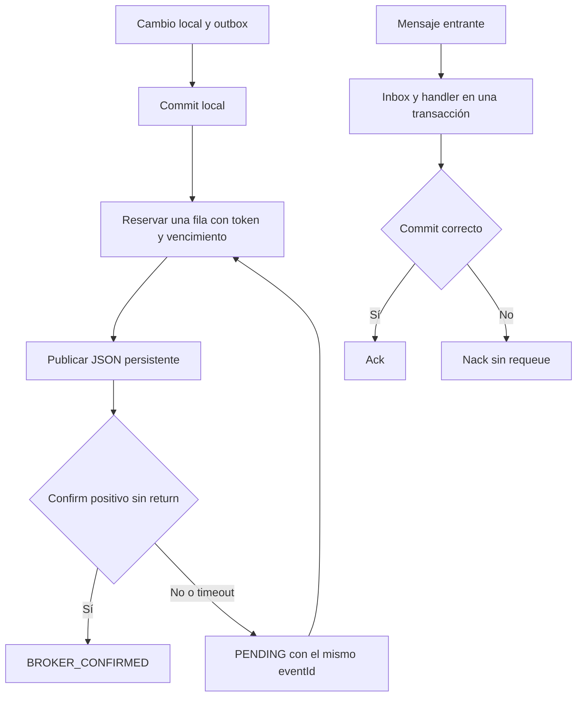

# Integración técnica con Core

El backend incorpora el cliente HTTP de máquina, la conexión AMQPS, outbox e inbox y una prueba técnica de autorrecepción. La integración está desactivada por defecto y en el perfil `docs`. No se conectaron todavía los servicios de negocio de Ciudadanos, Atención Ciudadana o Rentas.

La implementación sigue el [contrato contrastado con el código de Core](../roadmaps/00-contrato-core-verificado.md). El backend desplegado confirmó conexión AMQPS, TLS con verificación de certificado y hostname, autenticación y consulta pasiva de la cola propia. Core confirmó posteriormente la entrega del secreto HTTP rotado; su configuración y comprobación desde nuestro despliegue siguen pendientes, al igual que el intercambio técnico de eventos.

Actualización del 2 de noviembre de 2026: Core comunicó el módulo activo, entregó la credencial AMQPS propia y confirmó la habilitación de `187.127.41.168/32` al puerto 5671. Los logs del despliegue registraron `CORE_AMQP_CONNECTED` a las `13:23:16.173Z`, con cero mensajes y consumidores en ese instante. Los alcances y pendientes están en el [registro de evidencias](../roadmaps/evidencias-core.md). La contraseña recibida no forma parte de los archivos versionados.

El [dashboard de integración](core-dashboard.md) agrega siete endpoints protegidos de lectura para comprobar HTTP y AMQPS, consultar métricas, publicaciones, suscripciones y eventos. Su guía explica cómo cargar `CORE_MACHINE_SECRET`, probar desde Swagger y asignar `integrations:core:view` sin exponer credenciales al navegador.

## Componentes

| Componente | Responsabilidad |
| --- | --- |
| `CoreProperties`, `CoreAmqpConfiguration` | Configuración condicional y clientes con TLS, sin declaraciones activas de topología. |
| `CoreEnvelopeCodec` | Sobre propio, `occurredAt` con zona, validación de campos y hash canónico. |
| `CoreTokenClient`, `CoreApiClient` | Token de máquina en memoria, renovación concurrente controlada y un único reintento ante 401. |
| `CoreRegistryClient` | Consulta del mapa y operaciones deliberadas de registro; nunca se ejecutan al arrancar. |
| `CoreEventClient`, `CoreHttpTransport.readiness()` | Diagnóstico de eventos, entregas, DLQ y cuerpo de readiness. |
| `CoreOutboxService`, `CoreOutboxStore` | Persistencia atómica con el llamador, reservas y recuperación de intentos. |
| `CoreAmqpPublisher`, `CoreOutboxPublisher` | Mensajes persistentes, confirm correlacionado, returns, backoff y conservación del UUID. |
| `CoreInboxService`, `CoreMessageListener` | Deduplicación transaccional y ack después del commit; fallo con nack sin requeue. |
| `CoreProbeHandler` | Recibe el contrato técnico acordado, comprueba `runId` y no produce un eco. |
| `CoreConnectionCheckRunner` | Comprueba AMQPS y cola pasiva una vez al arrancar si se habilita, con log de éxito o fallo sin detener el backend. |

Se agregó únicamente `spring-boot-starter-amqp`, administrado por la versión de Spring Boot del proyecto, porque se necesita el cliente RabbitMQ. HTTP utiliza `RestClient` y JSON utiliza el `JsonMapper` de Jackson 3 existente.

## Configuración y arranque

`.env.example` enumera las variables `CORE_*`. El archivo `.env` se carga mediante el mecanismo privado del entorno de ejecución; Spring no lo importa automáticamente por agregar esta integración. La configuración de lanzamiento existente de VS Code sí contempla ese archivo.

| Variable | Uso y valor inicial |
| --- | --- |
| `CORE_ENABLED` | `false`. Activa los componentes técnicos y exige configuración AMQPS. |
| `CORE_AMQP_CHECK_ON_STARTUP` | `false`. Con `true`, comprueba conexión y cola en modo pasivo al arrancar. No publica ni consume mensajes. |
| `CORE_API_BASE_URL` | Base terminada en `/api/v1`; por defecto el dominio HTTPS de Core. |
| `CORE_MACHINE_SECRET` | Secret privado HTTP propio, independiente de `JWT_SECRET`. Puede estar vacío para comprobar solo AMQPS; se exige al obtener un token. |
| `CORE_AMQP_HOST`, `PORT`, `VHOST` | Dominio de Core, `5671`, `core`. |
| `CORE_AMQP_USERNAME`, `CORE_AMQP_PASSWORD` | Credenciales privadas propias. |
| `CORE_AMQP_TLS` | `true`. Solo se admite desactivarlo contra loopback para pruebas aisladas. |
| `CORE_QUEUE` | `q.desarrollo-social`, a contrastar con el registro real. |
| `CORE_PUBLISHER_ENABLED` | `false`. Activa el scheduler que envía la outbox. |
| `CORE_CONSUMER_ENABLED` | `false`. Activa el contenedor de la cola propia. Por ahora exige el handler técnico habilitado. |
| `CORE_PROBE_ENABLED`, `CORE_PROBE_RUN_ID` | `false` y UUID explícito de una prueba acordada. No generan mensajes por sí solos. |
| `CORE_CONNECT_TIMEOUT`, `CORE_READ_TIMEOUT` | `5s` y `10s`. |
| `CORE_CONFIRM_TIMEOUT`, `CORE_OUTBOX_LEASE_DURATION` | `10s` y `60s`; la reserva debe superar al timeout. |
| `CORE_OUTBOX_POLL_INTERVAL`, `CORE_OUTBOX_BATCH_SIZE` | `5s` y `20`. Se reserva una fila por vez antes de esperar su confirm. |
| `CORE_OUTBOX_RETRY_DELAY`, `CORE_OUTBOX_MAX_RETRY_DELAY` | `5s` y `5m`, con incremento exponencial para el envío pendiente. Son independientes del retry de entrega administrado por Core. |
| `CORE_CONSUMER_PREFETCH` | `1`, con un consumidor inicial. |

No hay `RabbitAdmin`, beans de colas/exchanges/bindings ni reintentos automáticos del template o listener. La configuración automática de Rabbit y su health contributor se excluyen para impedir conexiones involuntarias cuando `CORE_ENABLED=false` y para mantener la salud local independiente de Core.

Con la integración habilitada se construyen los clientes sin iniciar solicitudes HTTP. El consumo y el scheduler tienen interruptores separados. Si se habilita la comprobación de arranque, solo se abre AMQPS y se consulta pasivamente la cola. Una configuración AMQPS incompleta falla al iniciar con un mensaje que no expone secretos; una caída remota queda registrada y no detiene el backend. Usar la API sin su secret produce `CORE_HTTP_SECRET_MISSING` antes de enviar la solicitud.

## Primer despliegue para comprobar AMQPS

Agregar al entorno de ejecución del contenedor del backend, junto con sus variables de base de datos y JWT:

```dotenv
CORE_ENABLED=true
CORE_AMQP_CHECK_ON_STARTUP=true
CORE_AMQP_HOST=core-uade-2026.duckdns.org
CORE_AMQP_PORT=5671
CORE_AMQP_VHOST=core
CORE_AMQP_USERNAME=module_desarrollo-social
CORE_AMQP_PASSWORD=REEMPLAZAR_CON_PASSWORD_DEL_ARCHIVO_PRIVADO
CORE_AMQP_TLS=true
CORE_QUEUE=q.desarrollo-social
CORE_MACHINE_SECRET=
CORE_PUBLISHER_ENABLED=false
CORE_CONSUMER_ENABLED=false
CORE_PROBE_ENABLED=false
```

Reemplazar únicamente el placeholder de contraseña con el valor `password` del JSON privado vigente. Cargarlo en el entorno privado del despliegue y recrear el contenedor para aplicar los cambios. No hace falta ejecutar `testCoreConnectivity` para esta primera comprobación.

El workflow del repositorio publica las imágenes Docker; el resultado de CI o de publicación no acredita que el contenedor del VPS esté actualizado. Verificar la imagen desplegada y sus logs después de recrearlo.

```bash
docker ps --format 'table {{.Names}}\t{{.Image}}'
docker logs --since 10m -f NOMBRE_DEL_CONTENEDOR_BACKEND
```

En el arranque correcto aparece una línea con este formato; los contadores son datos reales de la cola, no valores exigidos:

```text
CORE_AMQP_CONNECTED host=core-uade-2026.duckdns.org port=5671 vhost=core queue=q.desarrollo-social tls=true certificateVerification=true hostnameVerification=true pendingMessages=0 activeConsumers=0
```

Esa línea acredita conexión, TLS, autenticación y consulta pasiva de la cola en ese arranque. La comprobación no lee eventos ni necesita que los contadores estén en cero. No prueba publicación, procesamiento de eventos o acceso HTTP. No es un monitor continuo: para repetirla después de corregir una configuración, reiniciar o recrear el backend.

Ante un fallo aparece `CORE_AMQP_CONNECTION_FAILED ... code=<código> backendContinues=true`. Los códigos distinguen DNS, conexión, timeout, TLS, autenticación, permisos o recurso ausente. Si no aparece ninguno de los dos marcadores, comprobar que `CORE_ENABLED` y `CORE_AMQP_CHECK_ON_STARTUP` estén en `true` en el proceso desplegado y que la imagen incluya este cambio.

Desde el propio entorno de salida puede verificarse la IP con `curl -4 --noproxy '*' https://checkip.amazonaws.com`. Core informó habilitada `187.127.41.168`; si la salida efectiva es otra, requiere la actualización de esa habilitación antes de interpretar un timeout como un error de credenciales.

## Persistencia

El [script de esquema](../database/core-integration.sql) agrega únicamente `core_outbox` y `core_inbox`, sin seeds ni cambios de datos de negocio. Revisarlo y aplicarlo deliberadamente en la base propia antes de habilitar la integración. El proyecto conserva su política existente de `JPA_DDL_AUTO`: con `update`, Hibernate también puede crear las tablas de las entidades al arrancar, aunque los clientes de Core estén desactivados. Para administrar el esquema exclusivamente por SQL, usar la política de DDL correspondiente al despliegue.

La operación `CoreOutboxService.enqueue` exige una transacción ya activa (`MANDATORY`). Al integrar negocio más adelante, se llama dentro del mismo método transaccional que guarda el cambio local. No hay publicación de red dentro de esa transacción.



La outbox usa UUIDv4 por hecho y serialización inmutable. Una reserva vencida puede retomarse; un token anterior no puede confirmar otro intento. `BROKER_CONFIRMED` acredita recepción por RabbitMQ, no aceptación de Core ni procesamiento de negocio. No se reenvía automáticamente por HTTP ni se publica otra vez para corregir `REJECTED` o `NO_SUBSCRIBERS`.

La inbox registra metadatos y hash, sin guardar por defecto el payload entrante completo. Un UUID repetido con el mismo contenido se confirma sin otro efecto. Un UUID reutilizado con contenido diferente se rechaza. Si falla el handler, su inserción se revierte; si el commit terminó y falla el ack, una redelivery se deduplica.

## Verificación local

```bash
./gradlew test --tests 'com.uade.dda2.server.feature.integration.*' --no-daemon
./gradlew bootJar generateOpenApiDocs --no-daemon
```

La suite técnica usa HTTP local, adaptadores controlados y H2 en modo PostgreSQL. Verifica formato, error de fecha, campos extra, hash lógico, cache y renovación del token, filtrado de publicaciones propias, confirms/returns, ack/nack, rollback, reservas y duplicados. No acredita permisos, TLS, TTL, PostgreSQL real ni ruteo del despliegue AWS.

La suite normal excluye la etiqueta `core-smoke`. La generación de OpenAPI usa integración desactivada y no necesita accesos de Core.

## Prueba remota de publicación y recepción

La tarea `testCoreConnectivity` no se ejecuta como parte de `test` ni registra nada automáticamente al arrancar el backend. Antes de habilitarla, cumplir los [prerrequisitos del roadmap remoto](../roadmaps/03-core-prueba-y-habilitacion.md): contrato técnico acordado, permisos propios, IP habilitada, worker activo, suscripciones compatibles y backlog resuelto. La prueba no purga mensajes ni pausa contratos de negocio.

Además de los accesos `CORE_*`, cargar en el entorno privado:

| Variable | Requisito |
| --- | --- |
| `CORE_SMOKE_ENABLED` | `true`, habilitación explícita de esta tarea. |
| `CORE_PROBE_RUN_ID` | UUID de esta ejecución, también utilizado como correlación. |
| `CORE_SMOKE_EVENT_ID` | UUIDv4 nuevo para el hecho de prueba. |
| `CORE_SMOKE_DB_CONFIRMED_DISPOSABLE` | `true`. |
| `CORE_SMOKE_DB_URL` | JDBC PostgreSQL sin parámetros, base llamada `core_smoke_<nombre>`, distinta de `DB_URL`. |
| `CORE_SMOKE_DB_USERNAME`, `CORE_SMOKE_DB_PASSWORD` | Accesos a esa base técnica desechable. |
| `CORE_SMOKE_REGISTER` | Por defecto ausente/false. `true` permite crear deliberadamente los registros técnicos faltantes; no sobrescribe schemas distintos ni reactiva registros pausados. |

```bash
./gradlew testCoreConnectivity --no-daemon
```

La tarea inicializa solo el esquema técnico en la base desechable. Comprueba readiness leyendo el cuerpo, verifica o registra el tipo propio `socialCoreConnectivityProbe`, su publicación y su suscripción, confirma que no haya otros módulos suscriptos a ese tipo ni otras suscripciones activas propias, y comprueba pasivamente que la cola no tenga mensajes pendientes ni otros consumidores M8 compitiendo. La tarea no utiliza resultados de ejecuciones anteriores en caché.

Después publica por outbox y AMQPS, recibe en la misma cola, consulta el evento por UUID y verifica `ingestionChannel=AMQP` e inbox local. El contenedor se detiene en el cierre, incluso ante fallo. Los registros de Core y las evidencias locales se conservan para inspección; su pausa o retiro se coordina después con Core. La prueba no cambia el modo de arranque del backend habitual.

Si la cola o las suscripciones no cumplen esas condiciones, la tarea se detiene antes de consumir. No debe habilitarse el consumidor normal hasta resolver esa situación y disponer de los handlers necesarios.

## Observaciones de la FAQ recibida

La FAQ común aportada durante la implementación describe el mismo sobre propio y el registro autoadministrado, pero contiene `occuredAt` en la tabla y backoffs de 15 s, 1 min, 5 min y 15 min. El código revisado y la confirmación posterior del equipo Core usan `occurredAt`; el snapshot tiene otros defaults de retry. Nuestra implementación no acepta la errata ni impone a Core una secuencia de espera.

Las operaciones de registro son explícitas y autoadministradas; coordinamos la publicación de prueba porque el ambiente es compartido. El token se trata como credencial opaca para llamar a Core, separado de la autenticación local de usuarios.
