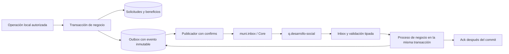

# Eventos de negocio M8 sobre Core

La implementación usa el contrato final **Contrato de eventos M8 para backend** y **Eventos M2 V1.79**. El documento de M2 mantiene los schemas v1.78: su versión editorial no cambia `eventVersion`, que sigue siendo `1.0`. Reemplazan la lista preliminar y los ejemplos M8 anteriores.

## Contratos implementados

| Dirección M8 | Evento | Proceso |
| --- | --- | --- |
| Publica | `socialDocumentationRequested` | Al presentar una solicitud con requisitos documentales. Máximo diez, `correlationId=applicationId`. |
| Publica | `socialBenefitUpdated` | Un evento por otorgamiento, renovación, suspensión, finalización o vencimiento; `benefitId` estable. `ACTIVE→APPROVED`, `EXPIRED→FINALIZED`. No existe `REJECTED`. |
| Publica | `updateTicketStatus` | Toma de ticket, avance, pedido de información, devolución, resolución o rechazo operativo hacia M2. |
| Consume | `ticketUpdated` | Filtra área M8 y reclasificación; conserva snapshot ROUTED, gestiona respuestas, reaperturas, cancelaciones, duplicados y escalamiento. |
| Consume | `socialDocumentationDelivered` | Referencias de expedientes y documentos de M1, con validación de pertenencia y pedido causal. |
| Consume | `citizenUpdated` | Snapshot del usuario vinculado, domicilio, restricciones y fallecimiento. No aprovisiona usuarios. |
| Consume | `debtOverdue`, `debtSettled` | Consulta administrativa de deuda; no cambia elegibilidad. |
| Consume | `exemptionRequested`, `updateExemptionStatus` | Registra pedido/resolución de Rentas y vínculo con un otorgamiento TAX_EXEMPTION. |

No se publican `ticketUpdated` ni `overdueDebt` desde M8. No hay alias automáticos para contratos anteriores.



## Activación y esquema

Aplicar primero las migraciones existentes (incluida la eliminación del antiguo CHECK cerrado de `logs.entity_type`), de solicitudes, visitas, beneficios y [tablas técnicas Core](../database/core-integration.sql). Después, con la integración de negocio apagada, revisar y aplicar [la migración M8](../database/migrations/2026-11-02-m8-business-events.sql). Agrega tablas de tickets, cursores, contexto de Rentas y referencias documentales; amplía snapshots, cierres y atribución causal del historial. Incluye cuatro permisos administrativos y su asignación a ADMIN. No ejecuta cambios en Core.

`JPA_DDL_AUTO=update` no reemplaza la migración: Hibernate puede crear columnas y tablas, pero no actualizar los CHECK existentes de visitas y beneficios. No activar procesos de fallecimiento sin esos cambios. Respaldar la base antes de la migración y seguir la política de DDL del despliegue.

Conservar las credenciales y variables AMQPS/HTTP de [la guía de conexión](core-integration.md). La única variable nueva es:

```dotenv
CORE_BUSINESS_ENABLED=false
```

Para habilitar deliberadamente todo el circuito, después de validar contratos, suscripciones y backlog con Core:

```dotenv
CORE_ENABLED=true
CORE_BUSINESS_ENABLED=true
CORE_PUBLISHER_ENABLED=true
CORE_CONSUMER_ENABLED=true
CORE_PROBE_ENABLED=false
```

El publicador habilitado drena la outbox; el consumidor habilitado puede producir respuestas de negocio, por eso requiere el publicador. Con `CORE_BUSINESS_ENABLED=true` y transporte desactivado se pueden probar operaciones y guardar eventos PENDING localmente. Apagar el flag no borra la outbox existente. Antes de reactivar el publicador hay que revisar los eventos pendientes.

La aplicación usa recursos preexistentes: exchange `muni.inbox`, routing key vacía y cola `q.desarrollo-social`, vhost `core`. No declara exchanges, colas ni bindings. Los permisos restringidos entregados por Core siguen siendo suficientes. TLS y hostname verification se conservan. El publicador incluye el `user_id` AMQP con el usuario real de la conexión, según la recomendación de M2 v1.79; esto no implica que Core ya contraste ese atributo con `sourceModule`.

## Documentación autogenerada

Se usa [Springwolf AMQP](https://www.springwolf.dev/docs/quickstart/) **2.5.0**, cuya base Spring Boot 4.0 es compatible con el backend 4.0.7. Se agregan el scanner AMQP y su UI; no se cambia Spring Boot. [AsyncAPI](https://www.asyncapi.com/docs/reference/specification/v3.0.0) documenta mensajes y canales; OpenAPI continúa documentando HTTP.

- Visor: `/springwolf/asyncapi-ui.html`.
- Especificación JSON generada: `/springwolf/docs`.
- Exportación reproducible: `./gradlew generateAsyncApiDocs -Pkotlin.incremental=false`; resultado `build/asyncapi/asyncapi.json`.
- HTTP: `/swagger-ui/index.html`, `/api-docs` y `./gradlew generateOpenApiDocs`.

Los mensajes se descubren en los métodos `@AsyncPublisher` y `@AsyncListener` reales, con sobres genéricos que conservan el tipo de `data`. Las data classes y sus anotaciones declaran propiedades obligatorias, UUID, fechas, estados y restricciones. El formulario dinámico se documenta como objeto JSON arbitrario y la ubicación con sus cinco campos M2; no se publican los atributos internos de Jackson. La validación de entrada comprueba además presencia de claves obligatorias-nullables y evita coerciones de números, UUID y fechas. Las reglas condicionales se validan en `M8PayloadValidator` y se describen en los schemas; la especificación generada no equivale al registro de schemas de Core ni lo actualiza.

El visor es de lectura: publishing de Springwolf está apagado y los POST bajo `/springwolf/**` se deniegan. Las rutas GET son públicas, siguiendo Swagger de esta aplicación. Nunca contienen credenciales. Esto no agrega una herramienta para inyectar eventos en el entorno compartido.

## Reglas de negocio

**Vinculación M1.** Una operación que necesita emitir un evento de ciudadano exige previamente `users.external_citizen_id` con UUID canónico. Si falta, responde `409 M8_CITIZEN_LINK_REQUIRED` y revierte toda la operación, incluida la outbox. No convierte IDs locales, DNI ni IDs numéricos de M1 a UUID y no ofrece una vinculación administrativa sin verificación. El flujo de identidad/login M1 sigue pendiente de acuerdo externo.

**Beneficios.** Se conserva el otorgamiento y su historial local. El evento usa una sola prestación, `programName` de la edición y `amount` presente aun si es null. Las suspensiones y finalizaciones llevan motivo; los APPROVED no llevan motivo de renovación interno. El vencimiento conserva la fecha prevista; la finalización usa la fecha efectiva del cambio. El detalle administrativo del historial expone `causationEventId` y `effectiveEndDate`; las solicitudes exponen sus datos de cierre sin reemplazar su resolución anterior. Un fallecimiento usa `deceasedAt`, incluso si es anterior al inicio previsto, conservando las fechas originales en el otorgamiento y en el historial.

**Tickets.** La fecha `data.updatedAt` se compara antes de cualquier cambio, incluso ante una reasignación a otra área. De broadcasts ajenos se guarda únicamente un cursor técnico para descartar ROUTED atrasados, sin su contenido. Se ignora `purpose=RECLASSIFICATION`. ROUTED crea/actualiza una sola gestión por `ticketId`; `reassignment=true` reinicia el ciclo de toma. STARTED sale una sola vez al asignar administrativo. REOPENED e INFORMATION_PROVIDED actualizan la causa y permiten continuar con PROGRESS/RESOLVED; no generan otro STARTED. La respuesta conserva la correlación del hecho de M2 al que responde.

`INFORMATION_PROVIDED` conserva el mensaje y los adjuntos de `data.attachments`; `ESCALATION_CHANGED` lee `details.escalation`. `formData`, `location`, `resolutionDueAt` y `escalation` son opcionales en ROUTED conforme a M2 v1.79. Los anónimos no necesitan usuario ni solicitud social. Los tickets identificados se pueden vincular a una solicitud del mismo ciudadano. La asignación manual o automática al evaluar, las visitas programadas/reprogramadas (también al aprobar un pedido de reprogramación) y ambas rutas de resolución generan actualizaciones dentro de la misma transacción. La ruta anterior de resolución usa ahora el mismo orden de locks que Core y mantiene el contador de cupos al aprobar; evita ciclos de locks y permite liberar su reserva al finalizar. Cancelaciones, duplicados, cierres y reasignaciones detienen publicaciones de esa gestión. Un pedido de información pendiente impide publicar avances hasta recibir la continuación de M2.

**Documentación.** Una solicitud desconocida se confirma sin efectos. Una conocida exige identidad, programa, edición, requisito y `causationId` del pedido propio de outbox. PENDING no satisface un requisito. COMPLETED sólo registra entrega, queda PENDING de revisión y requiere revisión humana VALID/OBSERVED. Se guardan referencias externas separadas de los archivos binarios locales. La evaluación y renovación usan el estado revisado; un archivo local prevalece si ya existe para el requisito. Una nueva referencia documental vuelve a requerir revisión. El backend no inventa URLs de descarga de documentos M1: todavía debe coordinarse cómo obtiene el administrativo el contenido a revisar.

**Ciudadanos.** Sólo se actualizan usuarios ya vinculados. Snapshot personal y domicilio tienen relojes separados. BLOCKED impide nuevas solicitudes y queda visible en alertas administrativas; no suspende beneficios. DECEASED finaliza ACTIVE y SUSPENDED, registra motivo/fecha/evento causal, cancela visitas programadas, cierra solicitudes abiertas con CLOSED y libera el cupo reservado por una APPROVED. No modifica resoluciones históricas ni borra información. Los eventos FINALIZED y esos cambios comparten transacción e inbox: un fallo revierte todo; un replay no duplica eventos. El fallecimiento también impide nuevas solicitudes, según su condición terminal.

**Rentas.** Deuda y exenciones son contexto administrativo. `debtSettled` sólo se aplica a MUNICIPAL_TAX, ciudadano no null y deuda conocida. Los demás casos se confirman sin efectos; un overdue tardío no reactiva una deuda ya saldada conocida. Si una resolución de exención llega antes del pedido se conserva y luego se completa su contexto. Un único TAX_EXEMPTION activo del ciudadano permite vínculo automático; varias coincidencias requieren selección administrativa. REJECTED no requiere los campos de aprobación.

## Endpoints administrativos nuevos

Todos exigen JWT y permiso en el rol activo; el servicio vuelve a comprobar que el permiso siga asignado en la base.

| Método y ruta | Permiso |
| --- | --- |
| `GET /api/admin/integrations/core/tickets` y `/{ticketId}` | `tickets:management:view` |
| `PUT .../tickets/{ticketId}/assignee` | `tickets:management:manage` |
| `PUT .../tickets/{ticketId}/application` | `tickets:management:manage` |
| `POST .../tickets/{ticketId}/updates` | `tickets:management:manage` |
| `GET /api/admin/integrations/core/revenue/debts` y `/exemptions` | `revenue:management:view` |
| `PUT .../revenue/exemptions/{requestId}/benefit` | `revenue:management:manage` |
| `GET /api/admin/integrations/core/citizen-alerts` | `users:view` |
| `GET /api/admin/applications/{applicationId}/external-documents` | `applications:management:documents:view` |
| `PATCH .../external-documents/{requestId}/review` | `applications:management:documents:review` |

Listados de tickets, Rentas y alertas: páginas desde cero, `size` entre 1 y 100. Tickets admite `state` y `attention`; Rentas `citizenId`. Los cuerpos se describen en Swagger. La actualización de tickets devuelve `202 {eventId,status:"PENDING"}`: indica persistencia local, no entrega a M2. Los siete endpoints anteriores del dashboard técnico siguen disponibles.

Antes de habilitar fallecimiento, comprobar también que `program_edition.current_enrollment` coincida con las solicitudes APPROVED existentes. Si hay datos históricos inconsistentes, reconciliarlos con el equipo; el handler revierte ante un contador insuficiente y no resta por debajo de cero.

```sql
SELECT pe.id, pe.current_enrollment, count(a.id) AS approved
FROM program_edition pe
LEFT JOIN application a ON a.program_edition_id = pe.id AND a.status = 'APPROVED'
GROUP BY pe.id, pe.current_enrollment
HAVING pe.current_enrollment <> count(a.id);
```

## Verificación y pendientes externos

Pruebas locales: `./gradlew test -Pkotlin.incremental=false`, generación OpenAPI/AsyncAPI y `bootJar`. Los tests de negocio no publican ni consumen del broker compartido; ejercitan el mismo inbox, contratos, handlers, servicios, permisos, base transaccional y outbox.

Antes de producción, falta coordinar con Core y contrapartes:

1. Confirmar los diez nombres finales, sus schemas desplegados y los destinos de cada publicación; revisar las siete suscripciones y `maxAttempts` propios. No dar de alta automáticamente desde M8.
2. Resolver la adopción por M1 de UUID canónico, envelope y `citizenUpdated`, más el procedimiento de vinculación de cuentas y acceso autorizado a los archivos entregados. Su formato numérico anterior no se convierte silenciosamente.
3. Confirmar acceso HTTP desde el despliegue y comparar `/event-types/{eventType}` con los contratos acordados. El archivo M2 v1.79 describe los schemas, pero no adjunta el ZIP en formato máquina; comparar también ese paquete o el registro desplegado.
4. Aplicar y verificar la migración en una copia PostgreSQL antes del despliegue.
5. Revisar backlog de `q.desarrollo-social` y coordinar pruebas con `eventId` identificable, incluida repetición, errores y caídas. BROKER_CONFIRMED no acredita procesamiento final de Core o M2.
